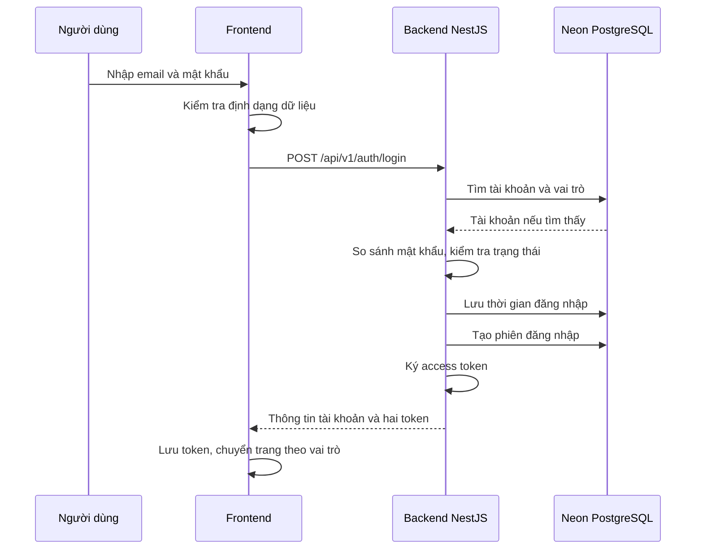

# Báo cáo kiểm tra lỗi đăng nhập ngày 22/10/2026

**Kết luận mới nhất sau đối chiếu 250/1.000 ms:** có bằng chứng thực nghiệm mạnh cho nguyên nhân trực tiếp của lỗi đã tái hiện: **ngưỡng thử từng địa chỉ 250 ms quá sát thời gian mở kết nối IPv4 tới endpoint Neon trên đường mạng hiện tại; khi các lần IPv4 hết hạn và IPv6 không có tuyến mạng, Node trả AggregateError ETIMEDOUT**. Người dùng đã chạy ngưỡng 1.000 ms: TCP mặc định kết nối sau 359 ms và `SELECT 1` thành công. Các lượt đối chiếu thêm từ công cụ tiếp tục cho thấy 250 ms có lúc lỗi, có lúc thành công; 1.000 ms thành công trong các lần đã quan sát. Đây là lỗi phụ thuộc thời gian kết nối, chưa có bằng chứng nguyên nhân do tài khoản tồn tại.

**Kết quả điều tra trước đó:** đã tái hiện `AggregateError ETIMEDOUT` khi mở kết nối tới Neon PostgreSQL, sau **756 ms**, rất gần **758 ms** trong log bạn cung cấp. Bằng chứng mạnh nhất hướng tới cơ chế Node tự chọn địa chỉ IPv4/IPv6: thời gian chờ mỗi lần thử là **250 ms**, trong khi kết nối IPv4 thực tế mất khoảng **248–262 ms**, còn đường IPv6 báo không có tuyến mạng. Tăng thời gian chờ mỗi lần thử lên **1.000 ms** giúp kết nối mặc định thành công trong các lần kiểm tra tiếp theo.

**Giới hạn:** có cả kết quả script người dùng cung cấp và kết quả trực tiếp từ công cụ, được tách riêng bên dưới. Chưa kiểm chứng cấu hình của PID Nest trong log và chưa thử lại login thật sau khi áp dụng tùy chọn cho Nest. Đã xác định cơ chế thất bại ở kết nối độc lập; chưa xác định chính xác câu lệnh đọc/ghi của từng request API, nguyên nhân sâu hơn của độ trễ mạng hoặc mức ổn định lâu dài.

## Đối chiếu mới nhất: tăng ngưỡng đã thành công trên máy người dùng

**[USER CLAIM — đầu ra được cung cấp]** Với `--network-family-autoselection-attempt-timeout=1000`, script ghi TCP mặc định thành công sau **359 ms**, TCP riêng IPv4 thành công sau **248 ms**, IPv6 vẫn `ENETUNREACH` sau **2 ms**, và `PostgreSQL SELECT 1` trả **ok**. Cảnh báo SSL vẫn xuất hiện nhưng không ngăn kết nối/truy vấn thành công trong lượt này.

**[SOURCE FACT — phép thử trực tiếp trong lượt cập nhật này]** Đã chạy tuần tự ba tiến trình script, giữ nguyên cấu hình URL và chỉ thay ngưỡng thử địa chỉ:

| Thứ tự | Ngưỡng | TCP mặc định | TCP riêng IPv4 | IPv6 | PostgreSQL SELECT 1 |
| --- | --- | --- | --- | --- | --- |
| 1 | 250 ms | Timeout sau 756 ms; 3 lỗi IPv4 timeout xen 3 lỗi IPv6 không có tuyến | Thành công 284 ms | `ENETUNREACH`, 2 ms | Thành công |
| 2 | 1.000 ms | Thành công 253 ms | Thành công 291 ms | `ENETUNREACH`, 4 ms | Thành công |
| 3 | 250 ms | Thành công 250 ms | Thành công 251 ms | `ENETUNREACH`, 2 ms | Thất bại: `AggregateError ETIMEDOUT`, 3 IPv4 timeout và 3 IPv6 không có tuyến |

Các số đo là thời gian của từng phép thử độc lập, không phải thời gian của một socket dùng chung. Script: [check-db-connection.js](../../MMO_Shopping_BE/scripts/check-db-connection.js), `probe` và `main`, dòng 40–68 và 129–159.

**[INFERENCE]** Kết quả quay về 250 ms vẫn có lần thành công không phủ nhận nguyên nhân theo thời gian; nó cho thấy không nên diễn đạt “250 ms luôn lỗi”. Kết nối đang ở sát ngưỡng, thời gian và địa chỉ được chọn có thể khác giữa các lần. Ngay trong lượt 1, probe mặc định lỗi nhưng client PostgreSQL sau đó thành công, ở lượt 3 thì ngược lại, probe mặc định thành công nhưng client PostgreSQL thất bại. Hai kết quả tiếp tục xác nhận các kết nối độc lập có thể có kết quả khác nhau. Số mẫu này chưa đủ để tính tỷ lệ lỗi hoặc cam kết ngưỡng 1.000 ms sẽ luôn thành công.

**Kết luận về phạm vi:** đã có thể ưu tiên xử lý ngưỡng mở kết nối thay vì tiếp tục điều tra dữ liệu tài khoản như nguyên nhân của lỗi TCP này. Chưa cần đổi URL, mật khẩu, schema hoặc tắt kiểm tra SSL để thử biện pháp đã có bằng chứng. Lỗi IPv6 là yếu tố đi kèm: vẫn tồn tại trong các lượt 1.000 ms thành công, nên riêng nó không đủ gây thất bại toàn bộ khi IPv4 kết nối được.

**Bước xác nhận còn lại trên ứng dụng:** dừng backend ở terminal của nó, rồi chạy từ thư mục backend:

```bash
NODE_OPTIONS="${NODE_OPTIONS:+$NODE_OPTIONS }--network-family-autoselection-attempt-timeout=1000" npm run start:dev
```

`NODE_OPTIONS` trong lệnh này được truyền cho tiến trình Node khởi chạy Nest và các tiến trình con; đặt tùy chọn trên script độc lập không làm thay đổi Nest đã chạy trước đó. Sau đó thử login đúng, login sai và `/auth/me`. Nếu còn lỗi, ghi ngưỡng hiệu lực trong chính tiến trình Nest và dấu mốc từng bước như phần dưới; không quy mọi 500 tiếp theo cho cùng nguyên nhân. Lần cập nhật này không khởi động/dừng Nest và không sửa cấu hình ứng dụng.

## Bổ sung kết quả script người dùng chạy: lỗi nằm trước truy vấn tài khoản

**[USER CLAIM — đầu ra script được cung cấp]** Đây là kết quả người dùng chạy trên terminal của mình, khác với các phép thử từ công cụ ở mục 3:

| Bước | Kết quả | Phạm vi đã thu hẹp |
| --- | --- | --- |
| Cấu hình | Node v24.13.0; `autoSelectFamily=true`; `attemptTimeoutMs=250` | Xác nhận cấu hình của tiến trình script trên máy người dùng |
| DNS | Phân giải được 3 IPv4 và 3 IPv6 | Phân giải tên miền đã thành công trong lần này |
| TCP tự chọn địa chỉ (`family=0`) | Thất bại sau 756 ms; 3 IPv4 timeout, 3 IPv6 `ENETUNREACH` | Các lần thử kết nối đều thất bại, không phải chờ câu SQL trả dữ liệu |
| TCP riêng IPv4 (`family=4`) | Thành công sau 271 ms | Có đường IPv4 tới cổng database; không phải mọi kết nối tới cổng 5432 đều bị chặn |
| TCP riêng IPv6 (`family=6`) | `ENETUNREACH` sau 1 ms | Đường IPv6 không khả dụng trong lần thử |
| Client PostgreSQL | `AggregateError ETIMEDOUT`, cùng cấu trúc lỗi con | Client cũng không mở được TCP trong lần này; chưa chạy tới truy vấn `SELECT 1` |

### Vì sao IPv4 thành công mà bước PostgreSQL vẫn lỗi?

**[SOURCE FACT — code]** Mỗi phép `probe()` tự tạo một socket, rồi đóng socket đó khi có kết quả. Sau ba phép thử, script tạo `new Client()` với kết nối riêng; không truyền `family=4` và không tái sử dụng socket đã kết nối được. Bằng chứng: [check-db-connection.js](../../MMO_Shopping_BE/scripts/check-db-connection.js), `probe`, dòng 40–68; `main`, dòng 129–147.

Vì vậy, `family=4 connected` chỉ chứng minh **phép thử IPv4 đó** thành công. Nó không chuyển cấu hình của lần kết nối PostgreSQL tiếp theo thành IPv4. Client tiếp tục đi theo chế độ mặc định của Node và có thể gặp lại chuỗi timeout.

**[SOURCE FACT — code + log]** Nhãn `PostgreSQL SELECT 1` hiện bao trùm cả `await client.connect()` và `await client.query(...)` trong cùng một `try/catch`. Với lỗi con `syscall=connect` vừa cung cấp, lỗi xảy ra khi mở kết nối; nhãn này không có nghĩa câu SQL đã được gửi rồi bị timeout. Bằng chứng: [check-db-connection.js](../../MMO_Shopping_BE/scripts/check-db-connection.js), dòng 145–155, và đầu ra script người dùng cung cấp.

### Cơ chế phù hợp nhất với các con số

**[EXTERNAL CONTEXT]** Node giới hạn thời gian thử từng địa chỉ khi bật tự chọn họ địa chỉ, ngoại trừ lần thử cuối cùng. Khi chỉ định riêng `family=4`, cơ chế tự chọn này bị bỏ qua. Đây là lý do ngưỡng 250 ms không có cùng tác dụng trong phép thử chỉ IPv4. [Node v24.13.0, socket.connect(options)](https://nodejs.org/download/release/v24.13.0/docs/api/net.html#socketconnectoptions-connectlistener).

**[INFERENCE]** IPv4 mất 271 ms, vượt ngưỡng thử 250 ms khoảng 21 ms; ba lần IPv4 timeout xen ba lần IPv6 lỗi nhanh tạo tổng khoảng 756 ms, rất sát `3 × 250 ms` cộng chi phí xử lý. Chuỗi nguyên nhân phù hợp nhất là: **đường IPv4 cần hơn ngưỡng chờ → các lần IPv4 bị bỏ qua → IPv6 không đi được → tất cả các lần thử thất bại → AggregateError**. Các phép thử có thể phân giải ra thứ tự IP khác nhau và không diễn ra cùng thời điểm; vì vậy đây là suy luận mạnh, chưa phải đo trực tiếp thời lượng từng địa chỉ trong cùng lần kết nối.

Cần tách ba tầng nguyên nhân:

- **Đã định vị lỗi tái hiện:** mở TCP; không cần dữ liệu email, mật khẩu hoặc bảng session để làm lỗi xuất hiện.
- **Cơ chế trực tiếp có bằng chứng mạnh nhất:** ngưỡng thử từng địa chỉ quá sát độ trễ IPv4, trong khi IPv6 không có đường đi.
- **Chưa xác định nguyên nhân sâu hơn:** vì sao đường IPv4 mất khoảng 271 ms và vì sao IPv6 không khả dụng. Log này không đủ để quy trách nhiệm cho nhà mạng, VPN, vùng đặt database hay cấu hình hệ điều hành.

Cảnh báo SSL nói về cách thư viện diễn giải `sslmode` và thay đổi trong phiên bản tương lai. Nó không phải exception dừng phép thử này: lỗi kết thúc được ghi rõ là `connect ETIMEDOUT/ENETUNREACH`. Chưa có bằng chứng lỗi TLS/chứng chỉ, sai mật khẩu database hoặc SQL trong lần thất bại này. Đây không đồng nghĩa các bước đó chắc chắn sẽ thành công sau khi TCP được sửa.

### Phép đối chiếu đã đề xuất ở lần trước (nay đã có kết quả phía trên)

Chạy trong thư mục backend, mỗi lệnh vài lần để tránh kết luận từ một lần thành công:

```bash
node scripts/check-db-connection.js
node --network-family-autoselection-attempt-timeout=1000 scripts/check-db-connection.js
```

Kết quả hỗ trợ giả thuyết: lệnh thứ hai in `attemptTimeoutMs:1000`, TCP mặc định thành công, và `PostgreSQL SELECT 1` trả `ok`. IPv6 vẫn có thể lỗi vì tăng thời gian chờ không tạo thêm tuyến IPv6; mục tiêu là IPv4 có đủ thời gian kết nối.

Nếu chỉ TCP thành công nhưng client PostgreSQL còn lỗi, phân loại lại theo mã lỗi mới thay vì mặc định quy mọi lỗi cho ngưỡng 250 ms. Nếu cả hai lệnh còn timeout, cần đo từng địa chỉ và thời lượng thử để kiểm tra đường mạng. `connectionTimeoutMillis:5000` trong script là giới hạn tổng ở client, không thay thế ngưỡng thử từng địa chỉ 250 ms; tăng riêng giới hạn tổng không đảm bảo giải quyết chuỗi lỗi này.

Để đối chiếu với API, sau khi phép thử trên xác nhận, khởi động lại Nest bằng lệnh `NODE_OPTIONS` ở mục 5 và thử login. Vẫn cần dấu mốc từng bước nếu muốn xác định chính xác request API trước đó thất bại tại thao tác đọc hay ghi. **Không cần chứng minh email tồn tại để giải thích lỗi TCP đã tái hiện độc lập.**

## Bổ sung log 23:19: phân biệt điều đã biết và điều chưa chứng minh

Áp dụng cách phân tích trong `research-reasoning-tutor.md`: tách quan sát trong log, hành vi được code chứng minh và suy luận về nguyên nhân. Các mốc dưới đây lấy từ log người dùng cung cấp, theo giờ Việt Nam ngày 22/10/2026. Không chép lại email cá nhân hoặc mật khẩu vào báo cáo.

| Thời điểm request | Nhóm email | Kết quả | Điều rút ra được |
| --- | --- | --- | --- |
| 23:19:01 | A: email người dùng xác nhận tồn tại | Timeout sau 768 ms | Một lần mở kết nối thất bại; chưa biết bước nào |
| 23:19:07 | A | Timeout sau 756 ms | Lỗi lặp lại, chưa chứng minh đã đọc được tài khoản |
| 23:19:13 | B: `user@example.com` | Timeout sau 755 ms | Lỗi kết nối cũng xuất hiện với email B |
| 23:19:24 | B: `user@example.com` | 401 sau 1.804 ms | Lần này bước tìm tài khoản đã hoàn thành, rồi code từ chối thông tin đăng nhập |

**[SOURCE FACT — code]** `AuthService.login` luôn đợi `accountRepository.findOne()` xong trước khi quyết định tài khoản có tồn tại. Cùng thông báo 401 được dùng cho hai trường hợp: không tìm thấy tài khoản, hoặc tìm thấy nhưng mật khẩu không khớp. Bằng chứng: [auth.service.ts](../../MMO_Shopping_BE/src/modules/identity/services/auth.service.ts), `login`, dòng 192–213.

Vì vậy, hai nhận định của bạn cần điều chỉnh như sau:

1. **“DB vẫn kết nối được”: được hỗ trợ ở lần trả 401.** Với code hiện tại, lần này đã vượt qua bước đọc database. **“DB nhận biết tài khoản không tồn tại”: chưa thể xác định chỉ từ 401**, bởi sai mật khẩu cũng cho cùng kết quả. Việc email B thực sự không tồn tại vẫn là thông tin cần kiểm chứng riêng.
2. **“Tài khoản tồn tại thì lại lỗi 500”: đúng với các lần thử A được cung cấp, nhưng chưa chứng minh quan hệ nhân quả.** Quan hệ nhân quả nghĩa là sự tồn tại của tài khoản thực sự dẫn đến lỗi. Ở đây B cũng từng timeout, và code chưa ghi dấu mốc đọc xong tài khoản ở các lần thất bại. Bằng chứng: bảng thời gian phía trên và `findOne` trước nhánh kiểm tra tồn tại, dòng 192–197.

**[INFERENCE]** Sự khác biệt hiện có là giữa các lần request, chưa phải bằng chứng về khác biệt giữa hai loại tài khoản. Các lỗi cùng PID 15324 cho thấy cùng một tiến trình có thể vừa thất bại kết nối vừa đọc được database. Điều này không phù hợp với giả thuyết database hoàn toàn không truy cập được trong toàn bộ khoảng thời gian này. Nó vẫn phù hợp với kết nối chập chờn, các lần tạo kết nối mới thất bại, hoặc khác biệt đường đi tới các địa chỉ đích; chưa thể chọn riêng một cơ chế từ log mới.

### Root cause hiện thu hẹp tới đâu?

- **Loại lỗi đã xác định:** mở kết nối mạng thất bại trong các request timeout; stack nằm ở `node:net/internalConnectMultiple`, không phải thông báo sai mật khẩu. Đây là quan sát từ log được cung cấp.
- **Giả thuyết mạnh nhất về cơ chế:** thời gian Node thử từng địa chỉ quá ngắn trên đường mạng hiện tại, kết hợp IPv6 không đi được. Bằng chứng là phép thử trước đó ở mục 3. Log mới tương thích với giả thuyết này, nhưng chưa xác minh cấu hình thực tế của PID 15324 và chưa cho biết các lỗi con của PID đó.
- **Chưa xác định vị trí trong login:** bước đọc tài khoản, lưu thời gian đăng nhập hay lưu phiên. Bằng chứng thứ tự code: `findOne` dòng 192, `accountRepository.save` dòng 226, `sessionRepository.save` dòng 244 trong [auth.service.ts](../../MMO_Shopping_BE/src/modules/identity/services/auth.service.ts).
- **Chưa có bằng chứng cho nguyên nhân do dữ liệu riêng của A.** Một lỗi ở nhánh chỉ chạy sau khi xác thực đúng vẫn có thể tồn tại song song, nhưng phải chứng minh `findOne` và kiểm tra mật khẩu của A đã thành công trước khi lỗi xảy ra.

**[SOURCE FACT — code]** `AggregateError` không được ánh xạ riêng trong filter hiện tại nên giữ HTTP 500 mặc định. Con số 500 cho biết backend không xử lý hoàn tất request; tự nó không xác định lỗi ở bước nào. Bằng chứng: [all-exceptions.filter.ts](../../MMO_Shopping_BE/src/common/filters/all-exceptions.filter.ts), `catch`, dòng 42–85.

### Dữ liệu tối thiểu cần thêm để chốt vị trí lỗi

Đây là đề xuất bổ sung log cho bước điều tra tiếp theo, **chưa được triển khai trong lần cập nhật báo cáo này**. Không cần ghi email, mật khẩu, token hoặc toàn bộ bản ghi tài khoản.

| Dấu mốc cần ghi cho từng request | Ý nghĩa nếu lỗi xuất hiện ở bước đó |
| --- | --- |
| `find_account`: bắt đầu / thành công / thất bại; thành công chỉ ghi `found=true/false` | Thất bại tại đây: chưa biết tài khoản tồn tại; lỗi trước khi so sánh mật khẩu |
| `verify_password`: thành công / bị từ chối | Xác định 401 do mật khẩu sau khi đã tìm thấy tài khoản; không ghi mật khẩu hay hash |
| `save_last_login`: bắt đầu / thành công / thất bại | Đã tìm thấy tài khoản, mật khẩu đúng, trạng thái hợp lệ; lỗi trong bước lưu thời gian đăng nhập |
| `save_session`: bắt đầu / thành công / thất bại | Đã lưu thời gian đăng nhập; lỗi trong bước tạo phiên |

Mỗi request cần một mã đối chiếu riêng (**request ID**) để không trộn dấu mốc của nhiều request. Tại bước thất bại, ghi có chọn lọc mã lỗi và các lỗi con `errors[]`, không chỉ stack tổng. Đồng thời ghi phiên bản Node, trạng thái tự chọn họ địa chỉ và thời gian thử mỗi địa chỉ của **chính tiến trình Nest đang chạy**; giá trị từ script độc lập không chứng minh cấu hình của Nest.

Cách đối chiếu giúp phân biệt hai giả thuyết: thử lặp lại email B, tài khoản A với mật khẩu sai, rồi A với mật khẩu đúng trên cùng cấu hình backend. Nếu cả B và A thất bại tại `find_account`, lỗi không cần nhánh ghi để xảy ra. Nếu các lần đọc đều thành công nhưng A với mật khẩu đúng thất bại ở `save_last_login` hoặc `save_session`, vị trí lỗi đã thu hẹp sang thao tác ghi tương ứng. Ngay cả khi đó, cần phân biệt lỗi mở kết nối của thao tác ghi với lỗi SQL/dữ liệu bằng mã lỗi con.

Phản hồi 401 mất 1.804 ms không cho biết thời gian đó dành cho kết nối, truy vấn hay so sánh mật khẩu: bộ ghi log đang đo tổng thời gian xử lý. Bằng chứng: [logging.interceptor.ts](../../MMO_Shopping_BE/src/common/interceptors/logging.interceptor.ts), dòng 22, 41–46. Không suy ra đã có retry chỉ từ thời lượng này.

## 1. Lỗi này nghĩa là gì?

- **TCP connection:** kết nối mạng cần mở tới database trước khi gửi câu truy vấn. Có thể hình dung là phải gọi điện nối máy trước khi hỏi thông tin.
- **DNS:** bước đổi tên máy chủ thành các địa chỉ IP. Trong phép thử ngoài sandbox, tên database trả về ba địa chỉ IPv4 và ba địa chỉ IPv6.
- **IPv4 / IPv6:** hai họ địa chỉ mạng. Một máy có thể đi được IPv4 nhưng không có đường đi IPv6.
- **ETIMEDOUT:** một lần kết nối hết thời gian chờ.
- **ENETUNREACH:** không có đường mạng tới địa chỉ đích.
- **AggregateError:** lỗi tổng hợp chứa nhiều lỗi con. Với cơ chế tự chọn họ địa chỉ của Node, nếu các lần thử đều thất bại, Node có thể gộp chúng thành một lỗi này. Thời gian chờ mỗi lần thử khác với thời gian chờ toàn bộ truy vấn. [Tài liệu Node v24.13.0: socket.connect](https://nodejs.org/download/release/v24.13.0/docs/api/net.html#socketconnectoptions-connectlistener).

**[USER CLAIM]** Log bạn cung cấp chứng minh request đã tới bộ ghi log của backend và thất bại sau 758 ms. Log đó chưa chứa lỗi con, địa chỉ đích hoặc tên bước trong login. Vì vậy không thể dùng riêng đoạn log để khẳng định chính xác câu truy vấn nào thất bại.

## 2. Luồng đăng nhập thực tế



**[SOURCE FACT]** Frontend kiểm tra dữ liệu, gọi `identityApi.login`, rồi chỉ lưu token và chuyển trang nếu API thành công. Khi lỗi, thông báo được đặt vào vùng lỗi mật khẩu. Bằng chứng: [LoginPage.tsx](../../MMO_Shopping_FE/src/pages/LoginPage.tsx), `handleSubmit`, dòng 22–56; [identityApi.ts](../../MMO_Shopping_FE/src/common/apis/identityApi.ts), `login`, dòng 14–15.

**[SOURCE FACT]** Đường dẫn API ghép từ prefix `api`, controller `v1/auth` và route `login`. Controller gọi trực tiếp `AuthService.login`. Bằng chứng: [main.ts](../../MMO_Shopping_BE/src/main.ts), dòng 12; [auth.controller.ts](../../MMO_Shopping_BE/src/modules/identity/controllers/auth.controller.ts), dòng 25, 42–48.

**[SOURCE FACT]** Trong `login`, các điểm cần database gồm tìm tài khoản/vai trò, lưu `lastLoginAt`, và lưu phiên đăng nhập. Sai email/mật khẩu trả 401; tài khoản không hoạt động trả 403. Bằng chứng: [auth.service.ts](../../MMO_Shopping_BE/src/modules/identity/services/auth.service.ts), `login`, dòng 191–265. Không có bước gọi email, Redis hay API cashback trong hàm login này.

**[INFERENCE]** Khi mở kết nối database bị timeout tại bất kỳ điểm đọc/ghi nào trên, backend chưa thể hoàn thành login để trả token. Bước tìm tài khoản là nghi phạm đầu tiên theo thứ tự thực thi, nhưng log hiện tại chưa đủ để xác nhận lỗi nằm ở bước này. Đây cũng chưa phải bằng chứng mật khẩu nhập sai.

**[SOURCE FACT]** `AuthService` dùng repository của TypeORM — lớp giúp đọc/ghi các bảng bằng đối tượng TypeScript. Dịch vụ `DatabaseService` dùng `neon()` là một đường truy cập database khác, không được inject vào `AuthService`. Sửa riêng dịch vụ đó sẽ không thay đổi kết nối của login. Bằng chứng: [auth.service.ts](../../MMO_Shopping_BE/src/modules/identity/services/auth.service.ts), constructor dòng 27–36; [database.service.ts](../../MMO_Shopping_BE/src/database/database.service.ts), constructor dòng 22–33; [identity.module.ts](../../MMO_Shopping_BE/src/modules/identity/identity.module.ts), dòng 19.

## 3. Kết quả đo thực tế

Đã thêm [scripts/check-db-connection.js](../../MMO_Shopping_BE/scripts/check-db-connection.js). Script đọc cấu hình với thứ tự ưu tiên tương tự backend, kiểm tra DNS, TCP và `SELECT 1`. `SELECT 1` chỉ yêu cầu database trả số 1 để xác nhận kết nối hoạt động; không đọc dữ liệu tài khoản và không sửa dữ liệu. Script không in URL, mật khẩu hoặc địa chỉ IP.

| Phép thử | Kết quả quan sát |
| --- | --- |
| Node của công cụ | v24.13.0, tự chọn họ địa chỉ bật, chờ 250 ms mỗi lần thử |
| DNS ngoài sandbox | Thành công, 3 địa chỉ IPv4 và 3 IPv6 |
| TCP mặc định, lần đầu | `AggregateError ETIMEDOUT` sau 756 ms |
| Lỗi con của lần đó | 3 lần IPv4 `ETIMEDOUT`, 3 lần IPv6 `ENETUNREACH` |
| TCP chỉ IPv4, ngay sau đó | Thành công sau 252 ms |
| TCP chỉ IPv6 | `ENETUNREACH` sau 57 ms |
| PostgreSQL bằng cấu hình hiện có | Kết nối và `SELECT 1` thành công |
| Tăng chờ mỗi lần thử lên 1.000 ms bằng API Node | TCP mặc định thành công sau 262 ms; `SELECT 1` thành công |
| Kiểm tra lại bằng cờ CLI 1.000 ms | TCP mặc định thành công sau 257 ms; IPv4 248 ms; IPv6 vẫn `ENETUNREACH`; `SELECT 1` thành công |

**[INFERENCE]** Kết hợp thời gian IPv4 nằm sát/vượt 250 ms, lỗi con và kết quả sau khi tăng chờ cho thấy cơ chế chọn địa chỉ quá gấp là lời giải thích mạnh nhất cho lỗi tái hiện. Việc truy vấn sau đó vẫn thành công giải thích tính chập chờn: không phải lần mở kết nối nào cũng thất bại. Các phép thử không đo cùng một địa chỉ tại cùng một thời điểm nên chưa chứng minh quan hệ nhân quả tuyệt đối.

**[SOURCE FACT]** Backend có `DATABASE_URL` nên ưu tiên URL này thay vì `DB_HOST`, `DB_PORT` và các trường `DB_*` khác. URL đang dùng endpoint Neon có pooler trên cổng 5432. Pooler là lớp điều phối kết nối database. Chỉ sửa `DB_HOST` trong khi URL vẫn tồn tại sẽ không đổi nơi login kết nối. Bằng chứng lựa chọn: [database.config.ts](../../MMO_Shopping_BE/src/config/database.config.ts), dòng 5–13; loại endpoint được xác minh từ cấu hình cục bộ, đã lược bỏ giá trị bí mật.

**[SOURCE FACT]** Frontend cục bộ dùng `/api/v1`, proxy tới `127.0.0.1:4000`; backend `.env` đặt cổng 4000. Cấu hình này khớp nhau. Bằng chứng: các giá trị không nhạy cảm trong hai file `.env`; [vite.config.ts](../../MMO_Shopping_FE/vite.config.ts), dòng 18–20; [httpClient.ts](../../MMO_Shopping_FE/src/common/apis/httpClient.ts), dòng 10. Không có bằng chứng sai cổng là nguyên nhân của request trong log.

## 4. Các vấn đề code đi kèm

| Vấn đề | Tác động và bằng chứng | Đề xuất |
| --- | --- | --- |
| Log thiếu lỗi con | `AllExceptionsFilter` chỉ ghi `exception.stack`; interceptor chỉ lấy `error.message`, có thể rỗng như log đã thấy. [all-exceptions.filter.ts](../../MMO_Shopping_BE/src/common/filters/all-exceptions.filter.ts), dòng 101–106; [logging.interceptor.ts](../../MMO_Shopping_BE/src/common/interceptors/logging.interceptor.ts), dòng 41–46. | Ghi có chọn lọc `code`, `syscall`, họ địa chỉ, cổng và `errors[]`/`cause`; thêm tên bước thất bại. Giữ các chi tiết chẩn đoán trong log máy chủ. |
| Lỗi database bị biến thành lỗi xác thực | `JwtAuthGuard` bọc cả xác minh token và truy vấn session trong cùng `try`, rồi đổi mọi lỗi thành 401. [jwt-auth.guard.ts](../../MMO_Shopping_BE/src/common/guards/jwt-auth.guard.ts), dòng 36–64. | Tách lỗi token khỏi lỗi hạ tầng; lỗi truy cập database nên được xử lý thành lỗi dịch vụ, chẳng hạn 503, thay vì báo token sai. |
| Có thể mất phiên khi database tạm lỗi | 401 từ API được bảo vệ kích hoạt refresh. Nếu refresh thất bại, frontend xóa token và báo hết phiên. Đây là hệ quả có thể xảy ra khi lỗi database đi qua guard ở trên. [httpClient.ts](../../MMO_Shopping_FE/src/common/apis/httpClient.ts), `shouldRefresh` và `handleRetryWithRefresh`, dòng 156–177. | Giữ phiên khi refresh thất bại do mạng hoặc 5xx; chỉ xóa phiên khi có bằng chứng refresh token không còn hợp lệ. |
| Login/refresh có nhiều lần ghi tách rời | Login lưu thời gian đăng nhập trước khi lưu session. Refresh thu hồi session cũ rồi mới tạo session mới, không có transaction bao quanh chuỗi ghi này. [auth.service.ts](../../MMO_Shopping_BE/src/modules/identity/services/auth.service.ts), dòng 225–244 và 322–347. | Transaction là nhóm thao tác cùng thành công hoặc cùng hủy. Cân nhắc dùng cho refresh để lỗi giữa chừng không để session cũ đã thu hồi mà session mới chưa được tạo. Đây là rủi ro đi kèm, không phải nguyên nhân mở kết nối timeout. |

**[SOURCE FACT]** Frontend chờ API tối đa 10 giây, còn log backend thất bại sau 758 ms. Tăng riêng timeout Axios không thay đổi ngưỡng thử địa chỉ của Node. Login cũng được loại khỏi luồng tự refresh khi nhận 401. Bằng chứng: [httpClient.ts](../../MMO_Shopping_FE/src/common/apis/httpClient.ts), dòng 23–27, 82 và 156–162.

## 5. Cách xử lý và tự kiểm tra

Từ thư mục gốc workspace, chạy phép kiểm tra hiện tại:

```bash
cd MMO_Shopping_BE
node scripts/check-db-connection.js
```

Sau đó đối chiếu bằng lệnh đã kiểm chứng:

```bash
node --network-family-autoselection-attempt-timeout=1000 scripts/check-db-connection.js
```

Nếu kết quả tương tự bảng trên, dừng backend đang chạy bằng Ctrl+C tại terminal của nó, rồi khởi động lại trong thư mục backend:

```bash
NODE_OPTIONS="${NODE_OPTIONS:+$NODE_OPTIONS }--network-family-autoselection-attempt-timeout=1000" npm run start:dev
```

Đây là cấu hình cho tiến trình được khởi chạy và các tiến trình Node con của nó; không thay đổi cấu hình mạng toàn máy. Chạy lại lệnh khởi động bình thường sẽ bỏ tùy chọn thêm trong lệnh này. Không cần sửa mật khẩu hay đổi database để thử giả thuyết này. Cờ được xác nhận có trong `node --help` của môi trường kiểm tra và [tài liệu CLI Node v24.13.0](https://nodejs.org/download/release/v24.13.0/docs/api/cli.html#--network-family-autoselection-attempt-timeout).

Kiểm tra trên giao diện:

1. Đăng nhập bằng thông tin đúng: API trả 201, frontend lưu token và chuyển trang đúng vai trò.
2. Thử mật khẩu sai: API trả 401 và thông báo tài khoản/mật khẩu không đúng.
3. Tải lại trang: `/auth/me` trả 200; các request được bảo vệ đọc được session.
4. Theo dõi thêm sau một khoảng nghỉ để bao phủ lần tạo kết nối mới; một lần thành công chưa đủ chứng minh hết lỗi chập chờn.

Nếu mặc định vẫn lỗi cả khi tăng chờ, dùng lỗi con từ script để điều tra tiếp. IPv4 cũng không kết nối được trong nhiều lần thử thì kiểm tra đường mạng, firewall/VPN và trạng thái endpoint. Nếu TCP kết nối được nhưng PostgreSQL thất bại, kiểm tra tiếp TLS/chứng chỉ và thông tin kết nối. Không nên chỉ đổi thứ tự DNS sang `ipv4first` rồi kết luận đã sửa: trong phép thử, các lần IPv4 cũng đã hết ngưỡng 250 ms.

Về lâu dài, có thể đặt thời gian chờ tổng kết nối database qua `connectTimeoutMS`, nhưng đó là giới hạn khác với thời gian thử từng địa chỉ. Cấu hình hiện tại chưa đặt trường này; driver TypeORM đang cài ánh xạ nó sang `connectionTimeoutMillis` của `pg`. Bằng chứng: [database.config.ts](../../MMO_Shopping_BE/src/config/database.config.ts), dòng 3–17; `node_modules/typeorm/driver/postgres/PostgresDriver.js`, `createPool`, dòng 1378. [Tài liệu pg Client](https://node-postgres.com/apis/client) giải thích thời gian chờ tổng kết nối.

## 6. Phạm vi đã hoàn thành

- Đã đọc luồng login, register, refresh, logout, `/me`, guard, lưu/khôi phục phiên frontend, cấu hình proxy và database.
- Đã chạy bộ unit test hiện có của `AuthService`: **1 suite, 3 tests đều pass**. Unit test dùng đối tượng giả lập repository, nên không chứng minh kết nối Neon thực tế ổn định. Bằng chứng: [auth.service.spec.ts](../../MMO_Shopping_BE/src/modules/identity/services/auth.service.spec.ts), phần khởi tạo mock và các test hiện có.
- Đã kiểm tra cú pháp script bằng `node --check` và chạy phép kiểm tra database chỉ đọc ngoài sandbox. Lần thử DNS trong sandbox gặp `EAI_AGAIN`; kết quả đó đã được tách khỏi kết luận mạng thực tế.
- Chỉ thêm script chẩn đoán và báo cáo này. Chưa sửa code nghiệp vụ, `.env`, hay khởi động lại backend của bạn. Các thay đổi có sẵn trong repo được giữ nguyên.
- Chưa chạy E2E tạo tài khoản/phiên trên database dùng chung; chưa xác minh login thực tế bằng mật khẩu của bạn. Lệnh khởi động trên là bước xác nhận còn lại trên ứng dụng đang chạy.

**Cập nhật bổ sung 23:19:** chỉ sửa báo cáo theo log mới, đối chiếu lại code login/filter/interceptor và sửa đường dẫn tương đối sau khi tài liệu chuyển vào `docs/bugs`. Không chạy thêm phép thử database hoặc thay đổi runtime; các kết quả test và đo mạng ở trên thuộc lần điều tra trước.

**Cập nhật với đầu ra script do người dùng cung cấp:** bổ sung phân tích TCP/IPv4/IPv6 và giải thích kết nối PostgreSQL độc lập; chưa chạy thêm phép thử, chưa đổi script hoặc cấu hình ứng dụng.

**Cập nhật sau phép thử 1.000 ms của người dùng:** đã chạy thêm ba lượt đối chiếu chỉ đọc 250 → 1.000 → 250 ms và ghi đầy đủ cả lượt 250 ms thành công. Chỉ cập nhật báo cáo; không sửa script, `.env` hoặc code nghiệp vụ.
