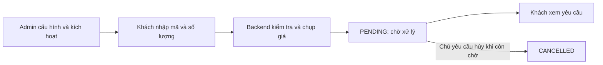

# Chung Sức — User Story và Business Rule

Ngày tổng hợp: **23/10/2026**. Phạm vi: nghiệp vụ tiếp sức mã mời trong game, đối chiếu source hiện có. Đợt này chỉ tổng hợp tài liệu, không thay đổi code hoặc dữ liệu.

**Chung Sức là dịch vụ khách gửi mã mời của mình trong game, chọn số tài khoản hỗ trợ, rồi shop dùng các tài khoản game của shop để tiếp sức cho mã đó.** Chủ shop vận hành bằng ADMIN; khách dùng tài khoản MMO với quyền USER. Nguồn về ý nghĩa dịch vụ: [README Chung Sức](../../MMO_Shopping_BE/README_CHUNG_SUC.md), mục “CHUNG SỨC Campaign”; [giao diện gửi mã](../../MMO_Shopping_FE/src/pages/chung-suc/JoinChungSucPage.tsx), các nhãn “Gửi mã mời”, “Số tài khoản hỗ trợ”.

Không cần role SELLER để sử dụng nghiệp vụ này. Dịch vụ Chung Sức và kết nối Hoàn Phí là hai nghiệp vụ riêng; xem [mô hình shop](single-owner-shop.md).

## 1. Cách đọc tài liệu

- **User Story:** nhu cầu của một người sử dụng, viết theo mẫu “Là …, tôi muốn …, để …”.
- **Business Rule:** điều kiện nghiệp vụ bắt buộc hoặc giới hạn của một thao tác.
- **Tiêu chí chấp nhận:** tình huống quan sát được để xác định tính năng có đáp ứng nhu cầu hay không.
- **Có code:** đã đối chiếu source; không đồng nghĩa đã kiểm thử trên DB hoặc game thật.
- **Dự kiến / cần chốt:** hướng xử lý chưa được triển khai hoặc chưa đủ căn cứ để coi là quyết định nghiệp vụ cuối cùng.

Các khẳng định hiện trạng dựa trên nguồn code cụ thể. Chính sách tính phí sau xử lý được tách riêng ở mục 7 vì docs cũ và thông điệp UI chưa thống nhất. Cách phân biệt bằng chứng theo [research-reasoning-tutor.md](../../research-reasoning-tutor.md).

## 2. Đối tượng và thuật ngữ

| Đối tượng | Hiểu đơn giản | Đối chiếu |
| --- | --- | --- |
| Khách / USER | Người đăng nhập MMO, gửi mã mời và xem yêu cầu của mình | `ChungSucController.joinCampaign`, `listMyRequests` |
| Chủ shop / ADMIN | Bạn tạo, cấu hình và quản lý chiến dịch | `ChungSucController.createCampaign`, các endpoint lifecycle |
| Tài khoản game của shop | Nguồn lực dự kiến dùng để thực hiện tiếp sức; khác tài khoản đăng nhập MMO của khách | Mô tả dịch vụ trong README và UI; chưa có luồng phân công tài khoản game trong module hiện tại |
| Campaign — chiến dịch | Một đợt dịch vụ gắn với sản phẩm, thời gian và giới hạn số tài khoản cho mỗi mã | [ChungSucCampaign](../../MMO_Shopping_BE/src/modules/chung-suc/entities/chung-suc-campaign.entity.ts) |
| Season — mùa/sự kiện | Nhóm sự kiện hoặc bối cảnh giá; campaign có thể không gắn season | `ChungSucCampaign.seasonId`, `ChungSucService.joinCampaign` |
| Invite code — mã mời | Mã khách lấy từ game rồi nhập vào website; không phải voucher hay mã giới thiệu Hoàn Phí | [JoinCampaignDto](../../MMO_Shopping_BE/src/modules/chung-suc/dto/campaign.dto.ts), `inviteCode` |
| Quantity — số tài khoản hỗ trợ | Số tài khoản shop được yêu cầu thực hiện tiếp sức cho một mã | `JoinCampaignDto.quantity`, `ChungSucCampaign.targetQuantity` |
| Yêu cầu tiếp sức | Một lần gửi mã + số lượng + người gửi + giá tại thời điểm gửi; tên entity hiện là Participant | [ChungSucParticipant](../../MMO_Shopping_BE/src/modules/chung-suc/entities/chung-suc-participant.entity.ts) |
| Snapshot giá — giá chụp lại | Đơn giá backend tính và lưu khi nhận yêu cầu, giúp theo dõi giá đã nhận | `ChungSucService.joinCampaign`, field `unitPrice` |
| Tools / worker | Chương trình dự kiến thực hiện công việc tiếp sức phía sau; worker là tiến trình xử lý công việc nền | Chưa có xử lý này trong `ChungSucService`; module automation hiện chỉ đăng ký entity |

Nguồn controller/service trong các bảng: [ChungSucController](../../MMO_Shopping_BE/src/modules/chung-suc/controllers/chung-suc.controller.ts), [ChungSucService](../../MMO_Shopping_BE/src/modules/chung-suc/services/chung-suc.service.ts).

## 3. Luồng đang có trong code

1. **Admin tạo campaign**: chọn sản phẩm tồn tại, tên, slug, thời gian và số tài khoản tối đa cho mỗi mã. Campaign mới ở `DRAFT` — bản nháp.
2. **Admin kích hoạt**: nếu chưa tới giờ bắt đầu thì thành `UPCOMING`; nếu đang trong thời gian nhận yêu cầu thì thành `ACTIVE`.
3. **Khách xem campaign đang chạy**, đăng nhập MMO và mở trang gửi mã.
4. **Khách nhập mã mời, chọn số tài khoản hỗ trợ và xem giá dự kiến**.
5. **Backend kiểm tra** người gửi, thời gian/trạng thái campaign, giới hạn số lượng, mã đang mở và giá hợp lệ; sau đó lưu yêu cầu `PENDING` — chờ xử lý.
6. **Khách xem yêu cầu của mình**; có thể hủy yêu cầu đang `PENDING`, chuyển thành `CANCELLED`.

Nguồn: `ChungSucService.createCampaign`, `activateCampaign`, `findActive`, `joinCampaign`, `listMyRequests`, `cancelRequest`; [ChungSucCampaignsPage](../../MMO_Shopping_FE/src/pages/chung-suc/ChungSucCampaignsPage.tsx), `activeCampaigns`; [JoinChungSucPage](../../MMO_Shopping_FE/src/pages/chung-suc/JoinChungSucPage.tsx), `handleSubmit`, `handleCancel`.

**Ranh giới hiện tại:** gửi yêu cầu chưa tạo đơn thanh toán, chưa trừ/giữ tiền trong ví, chưa gọi tools và chưa ghi nhận số tài khoản game thực sự tiếp sức thành công. Nguồn: `ChungSucService.joinCampaign` và các phương thức hiện có; [ChungSucModule](../../MMO_Shopping_BE/src/modules/chung-suc/chung-suc.module.ts); [AutomationModule](../../MMO_Shopping_BE/src/modules/automation/automation.module.ts).

## 4. User Stories đang có code

| Mã | User Story | Tiêu chí chấp nhận | Hiện trạng / nguồn |
| --- | --- | --- | --- |
| US-CS-01 | Là khách, tôi muốn xem chiến dịch đang nhận mã để chọn đúng sự kiện cần tiếp sức | Danh sách đang chạy chỉ gồm campaign ACTIVE và thời gian hiện tại nằm trong khoảng nhận yêu cầu; hiển thị mô tả, giới hạn mỗi mã, thời gian kết thúc | Có BE + FE; `findActive`, `ChungSucCampaignsPage` |
| US-CS-02 | Là khách đã đăng nhập, tôi muốn xem giá theo số lượng trước khi gửi | Backend tính đơn giá; giao diện hiển thị đơn giá và mức tối đa dự kiến bằng đơn giá nhân số lượng; gửi yêu cầu tính lại giá tại backend | Có BE + FE; `PriceEngineService.calculatePrice`, `JoinChungSucPage`, `joinCampaign` |
| US-CS-03 | Là khách, tôi muốn gửi mã mời và số tài khoản hỗ trợ để shop nhận yêu cầu | Mã không rỗng sau khi bỏ khoảng trắng hai đầu, tối đa 100 ký tự; số lượng nguyên từ 1 tới giới hạn; campaign hợp lệ; không trùng mã đang mở; thành công tạo PENDING và lưu giá | Có BE + FE; `JoinCampaignDto`, `joinCampaign`; BR-CS-03 tới BR-CS-09 |
| US-CS-04 | Là khách, tôi muốn xem các yêu cầu của mình để biết mã đã được tiếp nhận và trạng thái hiện tại | Chỉ đọc yêu cầu thuộc account đăng nhập; mã được che; API hiện lấy tối đa 50 yêu cầu gần nhất trên toàn bộ campaign | Có BE + FE; `listMyRequests`; FE lọc kết quả theo campaign đang xem |
| US-CS-05 | Là khách, tôi muốn hủy yêu cầu chưa xử lý để rút lại yêu cầu gửi nhầm | Chỉ chủ yêu cầu được hủy; trạng thái phải còn PENDING; chuyển CANCELLED và lưu thời điểm hủy; không xóa lịch sử | Có BE + FE; `cancelRequest` |
| US-CS-ADM-01 | Là chủ shop, tôi muốn tạo campaign cho một sự kiện game để công bố dịch vụ | Product tồn tại, slug chưa trùng, bắt đầu trước kết thúc, giới hạn mỗi mã là số nguyên dương; tạo DRAFT | Có BE + FE; `CreateCampaignDto`, `createCampaign`, `AdminChungSucPage` |
| US-CS-ADM-02 | Là chủ shop, tôi muốn sửa mô tả, giới hạn và thời gian để điều chỉnh việc nhận mã | Chỉ sửa các field cho phép; thời gian vẫn hợp lệ; không đổi product/season/slug/status bằng PATCH; không tự sửa giá/số lượng đã lưu ở yêu cầu cũ | Có BE + FE; `UpdateCampaignDto`, `updateCampaign` |
| US-CS-ADM-03 | Là chủ shop, tôi muốn kích hoạt, tạm dừng, kết thúc hoặc đóng campaign để kiểm soát việc nhận mã | Chỉ ADMIN; thao tác tuân thủ bảng chuyển trạng thái ở mục 6; khách không gửi mới khi campaign không ACTIVE hoặc ngoài thời gian | Có BE + FE; các phương thức lifecycle và `LIFECYCLE_ACTIONS` trong AdminChungSucPage |
| US-CS-ADM-04 | Là chủ shop, tôi muốn xem yêu cầu trong campaign và cập nhật tiến độ xử lý | API chỉ dành ADMIN; trả thông tin account cần thiết và mã đã che, không trả password/hash/bản mã mời đầy đủ. Đổi trạng thái theo BR-CS-16; mỗi lần đổi lưu người đổi, thời điểm, ghi chú | Có BE + FE; `getCampaignParticipants`, `updateRequestStatus` (`PATCH /v1/campaigns/requests/:requestId/status`); [AdminChungSucRequestsModal](../../MMO_Shopping_FE/src/pages/admin/AdminChungSucRequestsModal.tsx). Test: `tests/chung-suc/campaign.spec.ts`, mục “Admin processing requests” |

Nguồn giá: [PriceEngineService](../../MMO_Shopping_BE/src/modules/pricing/services/price-engine.service.ts), `calculatePrice`. Giá hiện dùng chính sách USER cho mọi account mua, gồm admin và seller cũ, theo [đợt tạm ngừng seller](../changes/seller-role-disabled-2026-10-23.md).

### User Stories cho giai đoạn hoàn thiện — chưa triển khai

| Mã | User Story dự kiến | Điều cần xác định trước khi coi là hoàn thành |
| --- | --- | --- |
| US-CS-NEXT-01 | Là khách, tôi muốn biết mã có hợp lệ trong game trước khi shop thực hiện tiếp sức | Tools kiểm tra điều kiện nào, mã hết hạn/đã đủ lượt xử lý ra sao; hiện validation chỉ kiểm tra dữ liệu nhập và mã trùng trong DB |
| US-CS-NEXT-02 | Là chủ shop, tôi muốn giao yêu cầu cho tools và nhận kết quả từng lượt | Cách chọn tài khoản game, kết quả nào tính thành công, chống dùng lại cùng tài khoản cho cùng mã, timeout và thử lại |
| US-CS-NEXT-03 | Là khách, tôi muốn thấy số lượt thành công, thất bại và số tiền thực thu | Chốt quy tắc tính phí ở mục 7; lưu số lượt/kết quả thực tế; ghi tiền một lần và hiển thị rõ |
| US-CS-NEXT-04 | Là chủ shop, tôi muốn xử lý yêu cầu lỗi hoặc thành công một phần để không bỏ sót khách | Chốt khi nào thử lại, lượt nào được thử lại, ai được thao tác, cách tránh thu tiền hoặc tiếp sức trùng |

Các story NEXT là bản phân rã công việc để thảo luận, chưa phải tính năng đang chạy hoặc chính sách đã được chủ dự án duyệt hết.

## 5. Business Rules hiện tại

| Mã | Quy tắc nghiệp vụ | Bằng chứng source |
| --- | --- | --- |
| BR-CS-01 | Shop là bên cung cấp dịch vụ. ADMIN quản lý campaign; thao tác cá nhân lấy account từ phiên đăng nhập, không cần SELLER | `ChungSucController`, `RolesGuard`; bản thay đổi seller |
| BR-CS-02 | Một campaign gắn một product; season tùy chọn. Khi tạo, product phải tồn tại, slug không trùng và thời gian bắt đầu nhỏ hơn kết thúc | `createCampaign`, `CreateCampaignDto` |
| BR-CS-03 | Chỉ nhận yêu cầu mới khi campaign ACTIVE và hiện tại nằm trong khoảng bắt đầu–kết thúc | `joinCampaign` |
| BR-CS-04 | Mã phải là string, bỏ khoảng trắng hai đầu, không rỗng, tối đa 100 ký tự. Chưa có bước kiểm chứng mã thực sự dùng được trong game | `JoinCampaignDto`, `joinCampaign` |
| BR-CS-05 | Số lượng là số nguyên, tối thiểu 1, không lớn hơn targetQuantity của campaign | `JoinCampaignDto.quantity`, `joinCampaign` |
| BR-CS-06 | targetQuantity là giới hạn cho MỖI mã, không phải số người cần gom hoặc tổng lượt cần đạt của campaign | Comment và field trong `ChungSucCampaign`; `joinCampaign` |
| BR-CS-07 | Một mã chỉ có một yêu cầu đang mở trong cùng campaign, kể cả do hai account khác nhau gửi. Mở gồm PENDING/CHECKING/PROCESSING | `assertCodeNotOpen`, `OPEN_PARTICIPANT_STATUSES`, index ở `ChungSucParticipant` |
| BR-CS-08 | Yêu cầu cạnh tranh cùng mã phải bị chặn ở DB; không chỉ dựa vào việc frontend tắt nút hoặc backend kiểm tra trước khi lưu | Unique index trong entity và migration `ReshapeChungSucForInviteCodes`; `joinCampaign` bắt lỗi unique |
| BR-CS-09 | Backend tính lại giá khi nhận mã; đơn giá phải lớn hơn 0 và được lưu vào yêu cầu. Giá hiển thị trước submit là dự kiến | `joinCampaign`, `PriceEngineService.calculatePrice`, `unitPrice` |
| BR-CS-10 | Gửi mã chỉ tạo PENDING, chưa tạo order hoặc trừ/giữ tiền. Không coi thao tác gửi thành công là đã tiếp sức thành công | `joinCampaign`; trường `orderId` chưa được gán tại bước này |
| BR-CS-11 | Khách chỉ xem/hủy yêu cầu của mình. accountId khác gửi từ client bị từ chối, account thật lấy từ phiên | `ChungSucController.joinCampaign`, `joinCampaign`, `listMyRequests`, `cancelRequest` |
| BR-CS-12 | Chỉ hủy khi còn PENDING, dùng cập nhật có điều kiện để không hủy đè lên trạng thái vừa đổi. Sau hủy giữ lịch sử; mã không còn bị chặn bởi yêu cầu đã hủy | `cancelRequest`, `assertCodeNotOpen`, partial unique index |
| BR-CS-13 | Mã lưu mã hóa; dùng hash có khóa để tra trùng. API chỉ trả mã đã che, không trả mã gốc/hash/bản mã hóa. Hiện không tự đổi chữ hoa/thường của mã | `CryptoService.hashLookup`, `encryptJson`; `JoinCampaignDto`; `toParticipantView` |
| BR-CS-14 | Thống kê hiện là số yêu cầu và tổng số tài khoản được yêu cầu, loại các yêu cầu CANCELLED. Đây chưa phải số tài khoản đã xử lý thành công và không phải số khách duy nhất | `getCampaignProgress`: `count`, `sum('quantity')`, điều kiện khác CANCELLED |
| BR-CS-16 | Admin chuyển trạng thái yêu cầu thủ công theo luồng PENDING → CHECKING/PROCESSING/FAILED, CHECKING → PROCESSING/FAILED, PROCESSING → SUCCESS/PARTIAL_SUCCESS/FAILED. SUCCESS/PARTIAL_SUCCESS/FAILED/CANCELLED là trạng thái cuối; chuyển sai luồng trả 409 `REQUEST_STATUS_TRANSITION_NOT_ALLOWED`. Cập nhật có điều kiện nên không ghi đè khi khách vừa hủy. Đổi trạng thái chưa tạo order, chưa trừ/giữ ví (mục 7) | `ADMIN_STATUS_TRANSITIONS`, `updateRequestStatus`, `metadata.statusHistory` |
| BR-CS-15 | completionConditions/rewards hiện là dữ liệu cấu hình; UI có thể hiển thị rewards nhưng chưa có cơ chế chứng minh đã nhận thưởng trong game | `createCampaign`, `updateCampaign`; `ChungSucCampaignsPage` |

Nguồn bổ sung: [ParticipantStatus](../../MMO_Shopping_BE/src/modules/chung-suc/enums/participant-status.enum.ts), [migration chống trùng](../../MMO_Shopping_BE/src/database/migrations/1791600000000-ReshapeChungSucForInviteCodes.ts), [CryptoService](../../MMO_Shopping_BE/src/common/crypto/crypto.service.ts). “Hash có khóa” ở đây là dấu tra cứu ổn định dùng để so trùng; “mã hóa” giữ nội dung để backend có thể giải mã khi cần xử lý.

## 6. Hai loại trạng thái cần phân biệt

### Trạng thái campaign — có đang nhận yêu cầu không?

| Trạng thái/thao tác | Ý nghĩa theo code |
| --- | --- |
| DRAFT | Campaign mới tạo, chưa nhận yêu cầu |
| Kích hoạt DRAFT/UPCOMING/PAUSED | Trước giờ bắt đầu thành UPCOMING; trong thời gian thành ACTIVE; đã hết giờ thì từ chối kích hoạt |
| ACTIVE | Có thể nhận mã nếu còn trong thời gian |
| Tạm dừng UPCOMING/ACTIVE | Chuyển PAUSED; không nhận mã mới |
| Kết thúc UPCOMING/ACTIVE/PAUSED | Chuyển ENDED; không nhận mã mới |
| Đóng campaign chưa CLOSED | Chuyển CLOSED theo các trạng thái được cho phép trong service; hiện không có thao tác mở lại CLOSED |
| COMPLETED | Còn trong enum để tương thích; code hiện không tự chuyển sang trạng thái này khi đủ tổng số lượng |

Nguồn: `ALLOWED_FROM`, `activateCampaign`, `pauseCampaign`, `endCampaign`, `closeCampaign`; [CampaignStatus](../../MMO_Shopping_BE/src/modules/chung-suc/enums/campaign-status.enum.ts).

**Giới hạn đã kiểm tra:** Có hàm `checkAndUpdateStatuses()` nhưng chưa tìm thấy nơi gọi theo lịch trong `src`. Vì vậy chưa thể khẳng định UPCOMING tự chuyển ACTIVE khi tới giờ. `findActive` và `joinCampaign` vẫn kiểm tra thời gian thực tế; ACTIVE quá hạn không được nhận mã. Tạm dừng/kết thúc/đóng campaign hiện chỉ đổi trạng thái campaign, không tự hủy các yêu cầu đã gửi. Nguồn: các hàm tương ứng trong `ChungSucService`, `ChungSucModule`.

### Trạng thái yêu cầu — mã cụ thể đã được xử lý tới đâu?

| Trạng thái | Nghĩa dự kiến | Tình trạng trong module hiện tại |
| --- | --- | --- |
| PENDING | Shop đã nhận yêu cầu, chờ xử lý | Đang được tạo |
| CANCELLED | Khách hủy khi còn chờ | Đã có thao tác chuyển |
| CHECKING | Đang kiểm tra mã/điều kiện game | Admin chuyển thủ công (BR-CS-16) |
| PROCESSING | Đang thực hiện tiếp sức | Admin chuyển thủ công (BR-CS-16) |
| SUCCESS | Đã tiếp sức đủ số lượng yêu cầu | Admin chuyển thủ công; chưa lưu số lượt thành công, cần định nghĩa bằng chứng thành công |
| PARTIAL_SUCCESS | Chỉ một phần số lượng thành công | Admin chuyển thủ công, ghi chú số lượt vào note; chưa có xử lý thanh toán |
| FAILED | Không thực hiện thành công | Admin chuyển thủ công; chưa có xử lý thanh toán. Mã được gửi lại vì không còn yêu cầu mở |

Nguồn: `ParticipantStatus`, `REQUEST_STATUS_LABELS` trong JoinChungSucPage; các hàm ghi trạng thái trong ChungSucService. Có tên trạng thái trong code không đồng nghĩa luồng đó đã hoạt động.

## 7. Điểm chưa chốt: tính tiền và gọi tools

**[CONFLICT] Có hai mô tả khác nhau trong repo:**

- Giao diện campaign hiện ghi “Ví chỉ bị trừ theo số tài khoản tiếp sức thành công”. Nguồn: [JoinChungSucPage](../../MMO_Shopping_FE/src/pages/chung-suc/JoinChungSucPage.tsx), phần dưới báo giá.
- Đặc tả automation cũ mô tả khách pay request bằng ví, tạo order rồi gửi tools. Nguồn: [POST_support_code_requests_id_pay.md](../api/automation/POST_support_code_requests_id_pay.md), mục “Mô tả”, “Ràng buộc nghiệp vụ”. Đây còn dùng entity SupportCodeRequest và trạng thái khởi tạo ACTIVE, khác campaign participant hiện tại khởi tạo PENDING.

Không tự ghép hai workflow thành một nghiệp vụ đã triển khai. Hiện cả bước tools và tính tiền của yêu cầu campaign đều chưa có trong source đã kiểm tra; `AutomationModule` chỉ đăng ký entity.

| Quyết định cần chốt | Vì sao ảnh hưởng nghiệp vụ |
| --- | --- |
| Thu tiền trước hay theo số lượt thành công? | Quyết định thời điểm trừ ví, số tiền thực thu, xử lý thất bại/một phần |
| Nếu thu theo thành công, có kiểm tra/giữ tiền trước khi chạy không? | Tránh shop đã thực hiện dịch vụ nhưng sau đó ví khách không đủ để thu |
| Một lượt thành công được chứng minh bằng gì? | Cần kết quả được xác nhận từ game/tool; không chỉ dựa vào gửi HTTP thành công |
| Timeout, thử lại, kết quả gửi lặp xử lý ra sao? | Tránh tiếp sức trùng hoặc thu tiền hai lần. Idempotency là cơ chế gửi lại cùng thao tác mà không tạo kết quả nghiệp vụ lần hai |
| Campaign dừng/đóng hoặc giảm giới hạn thì yêu cầu đang chờ xử lý thế nào? | Code chưa tự hủy/chạy tiếp/quyết toán các yêu cầu cũ |
| Có cho gửi lại mã từng thành công/thất bại và dùng lại tài khoản game không? | Hiện chống trùng chỉ xét yêu cầu đang mở; điều kiện game thực tế cần quy tắc riêng |

**[ILLUSTRATIVE EXAMPLE — giả định nếu chọn thu theo số lượt thành công]:** Khách yêu cầu 5 tài khoản, đơn giá chụp lại 2.000đ/lượt, mức tối đa dự kiến là 10.000đ. Nếu chỉ 3 lượt được xác nhận thành công thì tiền dịch vụ là 6.000đ theo chính sách đó. Đây là ví dụ để thảo luận, chưa phải cơ chế thu tiền đang chạy.

## 8. Các tình huống dùng để nghiệm thu

Đây là checklist nghiệp vụ, không phải báo cáo test đã chạy trong đợt tổng hợp này.

| Tình huống | Kết quả cần quan sát theo hiện trạng/quy tắc |
| --- | --- |
| Gửi mã hợp lệ, quantity trong giới hạn, campaign ACTIVE còn hạn | Tạo PENDING, lưu đơn giá, chưa trừ/giữ ví hoặc gọi tools |
| Gửi mã rỗng, chỉ khoảng trắng hoặc quá 100 ký tự | Từ chối |
| Quantity bằng 0, số lẻ, chuỗi số hoặc vượt giới hạn | Từ chối |
| Campaign nháp, tạm dừng, đóng hoặc đã hết thời gian | Không nhận yêu cầu mới |
| Hai account gửi cùng mã đang mở trong cùng campaign | Chỉ một yêu cầu mở được lưu; yêu cầu trùng bị từ chối, kể cả chạy đồng thời khi index đã được áp dụng |
| Khách A hủy/xem dữ liệu yêu cầu của B | Không được truy cập qua API cá nhân |
| Chủ yêu cầu hủy PENDING, rồi gửi lại mã khi campaign vẫn hợp lệ | Bản cũ CANCELLED được giữ; mã có thể tạo yêu cầu mới nếu không có yêu cầu mở khác |
| Admin đổi giá sau khi đã nhận yêu cầu | unitPrice đã lưu của yêu cầu cũ không tự đổi theo |
| Campaign có 10 yêu cầu, mỗi yêu cầu xin 3 tài khoản | Thống kê có thể là 10 yêu cầu và tổng 30 tài khoản được yêu cầu; không được ghi “30 lượt thành công” khi chưa có kết quả |
| Yêu cầu SUCCESS/PARTIAL_SUCCESS/FAILED và thu tiền sau tools | Chưa nghiệm thu được: cần triển khai và chốt chính sách mục 7 trước |

Tài liệu này tổng hợp nghiệp vụ từ source, không xác nhận game/tool, DB đang chạy hoặc thanh toán thực tế. API đầy đủ xem [mục lục campaign](../api/README), mục “chung-suc (tiếp sức mã mời)”.
