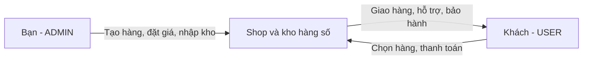

# Nghiệp vụ: một chủ shop tự bán hàng

Ngày: **23/10/2026**. Phạm vi ban đầu: xác định mô hình sản phẩm và hướng sửa tài liệu/code.

> **Cập nhật triển khai:** Theo yêu cầu tạm bỏ role seller, code đã chỉ hỗ trợ gán USER/ADMIN, ngừng API seller và giá seller. Tài khoản seller cũ dùng quyền USER trong runtime, giữ nguyên role/dữ liệu lưu trong DB cho tới khi chuyển đổi riêng. Xem [bản ghi thay đổi và kiểm tra](../changes/seller-role-disabled-2026-10-23.md). Các nhận xét hiện trạng ban đầu ở dưới cần đọc cùng cập nhật này.

## 1. Bản chất của hệ thống

**[USER CLAIM]** Chủ dự án xác nhận: “Tui chỉ có 1 mình thôi, tui tự cấp, tài khoản người dùng đến vs tui để mua hàng, tui vừa là seller vừa là admin.” Đây là yêu cầu nghiệp vụ làm cơ sở cho thiết kế đích.

**Quyết định thiết kế:** MMO Shopping là **single-owner shop** — cửa hàng có một chủ thể bán hàng. Chủ shop chịu trách nhiệm hàng hóa, giá, giao hàng, hoàn tiền và bảo hành. Không có luồng cho bên khác mở gian hàng, sở hữu kho riêng hay nhận chia tiền bán hàng trong phạm vi hiện tại.

Một người có thể vừa bán hàng vừa quản trị website. Tuy nhiên, **role** là nhóm quyền mà phần mềm kiểm tra, không phải mỗi công việc ngoài đời đều phải có một role. Quyền `ADMIN` đã đủ cho chủ shop vận hành việc bán hàng; không cần cấp thêm `SELLER` để nhập kho hoặc xử lý đơn.

Kết nối nhiều nền tảng/tool là **integration** — tích hợp với hệ thống khác. Có nhiều người bán độc lập là **multi-vendor**. Đây là hai chuyện khác nhau: shop của bạn có thể dùng nhiều tool và vẫn chỉ có bạn là bên bán hàng cho khách.

| Đối tượng | Ý nghĩa | Quyền trong thiết kế đích |
| --- | --- | --- |
| Khách chưa đăng nhập | Xem nội dung công khai | Không phải role lưu trong DB |
| Khách mua hàng | Mua từ shop, xem đơn/ví của mình, gửi yêu cầu hỗ trợ | `USER` |
| Chủ shop | Người cung cấp và vận hành shop | `ADMIN` |
| Nhà cung cấp/tool bên ngoài | Nguồn hàng hoặc dịch vụ shop sử dụng nếu có | Không tự trở thành seller/account của shop |

Một chủ thể kinh doanh không đồng nghĩa database bắt buộc chỉ có đúng một account `ADMIN`. Hiện chỉ có bạn vận hành; chưa cần thêm role `OWNER`, `STAFF` hoặc mô hình nhiều shop. Nếu dùng account admin để thử mua hàng, các API dành cho account chỉ thao tác trên giỏ/ví/đơn của account đó, tính giá khách hàng và tuân thủ cùng quy tắc thanh toán. Không mặc nhiên có giá seller hoặc quyền xem hàng đã giao của người khác qua API cá nhân.

## 2. Vì sao admin có kho hàng?

Kho là **kho hàng số của shop**, còn admin là người có quyền quản lý kho. `/admin/inventory` là màn hình làm việc của chủ shop; không phải shop riêng nằm trong tài khoản admin.

- **Product**: mặt hàng được giới thiệu, ví dụ “Tài khoản dịch vụ A”.
- **ProductVariant**: lựa chọn cụ thể được bán, ví dụ “Gói 30 ngày”; chứa giá và cách giao hàng.
- **InventoryItem**: một đơn vị hàng số có thể giao, ví dụ thông tin một tài khoản hoặc một mã kích hoạt. `payload` là nội dung hàng; backend mã hóa trước khi lưu.
- **Order/OrderItem**: đơn mua và từng dòng hàng, lưu thông tin tại thời điểm mua.

**[SOURCE FACT]** Trong source đã đọc, `Product` không có quan hệ người bán; `InventoryItem` liên kết variant và dòng đơn, không có `sellerId`. Controller kho kiểm tra `ADMIN`. Nguồn: [Product](../../MMO_Shopping_BE/src/modules/catalog/entities/product.entity.ts), [InventoryItem](../../MMO_Shopping_BE/src/modules/inventory/entities/inventory-item.entity.ts), [AdminInventoryController](../../MMO_Shopping_BE/src/modules/inventory/controllers/admin-inventory.controller.ts), các khai báo class tương ứng.

## 3. Seller hiện tại đến từ đâu?

**[CONFLICT]** [User stories](../database/userStory.md), mục “Roles chính”, mô tả `User`, `Admin`; nhưng [kiến trúc Chung Sức cũ](../../CHUNG_SUC_ARCHITECTURE.md), mục “Seller System”, thêm hồ sơ seller, phê duyệt, mã giới thiệu và hoa hồng. Hai phần đang mô tả phạm vi khác nhau, khiến người đọc tưởng có ba vai trò bắt buộc.

**[SOURCE FACT]** Nhánh seller trong code có hồ sơ chờ duyệt, sinh mã giới thiệu, đếm lượt click và thống kê. `getReferralStats()` hiện trả `totalOrders: 0`; `SellerProfile` có `commissionRate`, nhưng các phần đã kiểm tra chưa chứng minh có quy trình trả hoa hồng hoàn chỉnh. Nguồn: [SellersService](../../MMO_Shopping_BE/src/modules/sellers/services/sellers.service.ts), các hàm `approve`, `generateReferralCode`, `trackReferralClick`, `getReferralStats`; [SellerProfile](../../MMO_Shopping_BE/src/modules/sellers/entities/seller-profile.entity.ts).

**[INFERENCE]** Phần seller đã kiểm tra gần với **affiliate** — cộng tác viên dẫn khách qua mã giới thiệu — hơn là một người bán sở hữu sản phẩm/kho độc lập. Có API seller riêng vì code đã tách nhóm việc này thành module `sellers`. Điều đó không chứng minh dự án đã triển khai đầy đủ **marketplace** — sàn kết nối nhiều người bán độc lập với người mua.

Thiết kế đích bỏ vai trò seller nội bộ và luồng giới thiệu seller khỏi phạm vi shop. Không đổi tên module seller thành admin rồi giữ nguyên phê duyệt/hoa hồng: các nghiệp vụ ấy không cần cho việc bạn tự bán hàng. Nếu sau này cần cộng tác viên, thiết kế yêu cầu riêng và dùng tên phù hợp.

## 4. Các luồng cần giữ

### Bán hàng số

1. Chủ shop tạo product/variant, đặt giá, nhập từng hàng số vào kho.
2. Khách xem hàng, đăng nhập, thêm variant vào giỏ và nạp ví theo cơ chế của shop.
3. Checkout xác thực giỏ của khách, kiểm tra hàng còn bán, tính lại giá ở backend, áp voucher hợp lệ.
4. Trong **transaction** — nhóm thay đổi dữ liệu cùng thành công hoặc cùng hủy — backend ghi đơn, trừ ví/ghi sổ giao dịch và giữ/giao hàng để tránh hai khách nhận cùng một hàng.
5. Khách xem hàng đã mua; chủ shop xử lý hỗ trợ, hoàn tiền và bảo hành theo chính sách.

**[SOURCE FACT]** Checkout hiện tính từ `ProductVariant.price × quantity`, nhận `cartId?`, `voucherCode?`, và chỉ hỗ trợ giao tự động (`AUTO`). Không gọi `PriceEngineService` của nhánh mở rộng. Nguồn: [CommerceService](../../MMO_Shopping_BE/src/modules/commerce/services/commerce.service.ts), `checkout`, `calculateSubtotal`; [CheckoutDto](../../MMO_Shopping_BE/src/modules/commerce/dto/checkout.dto.ts). Không mô tả giao thủ công/tool như checkout sản phẩm đã hoạt động.

### Dịch vụ Chung Sức và tích hợp bên ngoài

**[SOURCE FACT]** Chung Sức hiện là khách gửi mã mời game để shop tiếp sức bằng các tài khoản của shop. `joinCampaign()` gọi Price Engine và lưu yêu cầu `PENDING`, chụp đơn giá; đoạn đã kiểm tra chưa trừ ví hoặc gọi tool tại bước này. Nguồn: [ChungSucService](../../MMO_Shopping_BE/src/modules/chung-suc/services/chung-suc.service.ts), `joinCampaign`.

Giữ Chung Sức như dịch vụ do shop cung cấp. Không diễn giải nó thành sàn seller hoặc tự mặc định là mua chung chỉ vì tên cũ có “Group Buying”. `SupportCodeRequest` trong docs automation cũ và yêu cầu campaign hiện tại cần đối chiếu riêng trước khi hợp nhất; đợt này không quyết định gộp hai workflow.

**[SOURCE FACT]** `/api/v1/cashback/referrals` thuộc kết nối Hoàn Phí 247 theo account, qua `CashbackService.getReferrals()`. Nguồn: [CashbackController](../../MMO_Shopping_BE/src/modules/cashback/controllers/cashback.controller.ts), route `referrals`; [CashbackService](../../MMO_Shopping_BE/src/modules/cashback/services/cashback.service.ts), `getReferrals`.

Giữ nghiệp vụ cashback hiện có độc lập với quyết định bỏ seller nội bộ. Không xóa mọi thứ có tên `referral`: mã giảm giá shop, mã mời game và giới thiệu từ Hoàn Phí là ba khái niệm khác nhau.

## 5. Những điểm còn phải kiểm tra khi sửa code

- **[UNVERIFIED]** Chưa đọc database đang chạy: chưa biết có bao nhiêu account `SELLER`, hồ sơ, đơn/lịch sử hoặc rule giá liên quan.
- **[SOURCE FACT]** Migration `AddChungSucSystem1788600000000.up()` thêm `orders.seller_id`, `seller_code`, trong khi class `Order` hiện không khai báo hai thuộc tính này. Nguồn: [migration](../../MMO_Shopping_BE/src/database/migrations/1788600000000-AddChungSucSystem.ts), đoạn “Add seller tracking to orders table”; [Order](../../MMO_Shopping_BE/src/modules/commerce/entities/order.entity.ts). Phải kiểm kê schema thật trước khi dọn.
- **[SOURCE FACT]** Trang `SellerDashboardPage.tsx` còn trên đĩa nhưng [AppRouter](../../MMO_Shopping_FE/src/routes/index.tsx) không khai báo route seller. Việc có file không chứng minh UI đang được dùng.
- Chưa thực hiện request runtime hoặc kiểm tra hệ thống đã triển khai. Kết luận hiện trạng dựa trên source trong workspace.

## 6. Thuật ngữ và cách tự kiểm tra

| Thuật ngữ | Hiểu đơn giản trong dự án |
| --- | --- |
| API / endpoint | Cách frontend yêu cầu backend làm việc; một endpoint là một địa chỉ kèm thao tác như `POST /checkout` |
| Authentication | Kiểm tra bạn là ai qua phiên đăng nhập/token |
| Authorization | Kiểm tra bạn được làm gì, ví dụ chỉ `ADMIN` được nhập kho |
| DTO | Hình dạng dữ liệu được phép gửi/nhận, ví dụ checkout không nhận `sellerCode` |
| Snapshot | Bản chụp giá/thông tin lúc mua; đổi giá hôm nay không sửa đơn hôm qua |
| Ledger | Sổ ghi từng lần cộng/trừ tiền, phục vụ kiểm tra và hoàn tiền |
| Idempotency | Gửi lại cùng một yêu cầu vẫn chỉ tạo một kết quả nghiệp vụ, tránh trừ tiền hai lần |
| Migration | Bước thay đổi cấu trúc/dữ liệu DB có kiểm soát |
| Legacy / deprecate | Phần cũ / đánh dấu ngừng dùng để thay hoặc loại bỏ có lộ trình |

**[ILLUSTRATIVE EXAMPLE]** Bạn nhập 10 mã gói 30 ngày giá `50000.0000`; khách mua 2 mã, không có voucher, tổng `100000.0000`. Sau giao, 2 hàng chuyển `SOLD`, 8 hàng còn bán. Không cần chọn seller, chia hoa hồng hoặc tạo ví nhận tiền cho một người bán khác. Đây là ví dụ giả định, không phải số liệu DB.

Bạn có thể tự kiểm tra cách hiểu: “Ai cung cấp hàng và chịu trách nhiệm bảo hành?” → Shop của bạn. “Ai được nhập kho?” → Account `ADMIN`. “Khách có được xem hàng trong đơn người khác?” → Không. Các tiêu chí sửa code nằm trong [plan](../plan/single-owner-shop.md).
