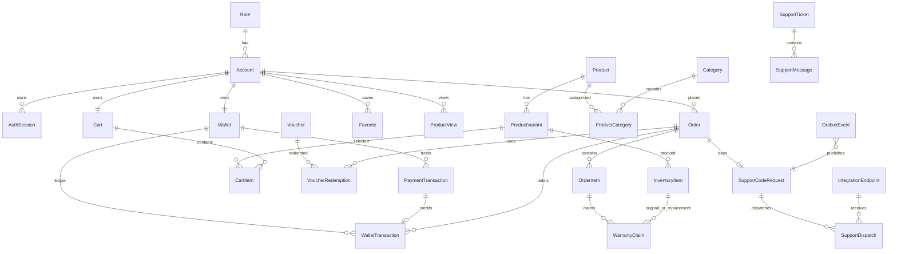

# Thiết Kế Database Entities Cho MMO Shopping

> Stack: PostgreSQL + TypeORM code-first trên NestJS.
> Domain: shop hàng số, ví nội bộ, voucher, mã tiếp sức gọi tools bên ngoài, ticket hỗ trợ và bảo hành.

> **Phạm vi đích — 23/10/2026:** Shop có một chủ thể bán hàng; `ADMIN` là chủ shop, `USER` là khách. Product/variant/inventory thuộc shop, không thêm `sellerId` hoặc bảng shop để chia kho. Đây là thiết kế dữ liệu cốt lõi, chưa liệt kê toàn bộ entity mở rộng trong source. Seller cũ và chênh lệch giữa migration với entity `Order` phải kiểm kê trước khi dọn; không được suy ra DB đang chạy chỉ có các bảng trong tài liệu này. Xem [nghiệp vụ](../business/single-owner-shop.md), [plan chuyển dữ liệu](../plan/single-owner-shop.md), [rule](../rule/business.md).

## 1. Kết Luận Thiết Kế

Thiết kế không còn giới hạn ở 17 entity ban đầu. Sau khi so với `userStory.md`, V1 cần thêm auth session, voucher redemption, mã tiếp sức, endpoint tools, ticket, bảo hành, outbox và audit.

Voucher và mã tiếp sức là hai nghiệp vụ khác nhau:

- `Voucher`: mã giảm giá khi checkout.
- `SupportCodeRequest`: code user nhập để Shop gửi sang tools bên ngoài sau khi thanh toán.

Rating/review chưa thuộc V1, nên filter theo rating chuyển sang V2.

## 2. Quy Ước Chung

| Quy ước         | Chuẩn                                                                      |
| :-------------- | :------------------------------------------------------------------------- |
| Primary key     | `uuid`, `gen_random_uuid()`/`@PrimaryGeneratedColumn('uuid')`              |
| Timestamp       | `timestamptz`                                                              |
| Money           | `numeric(19,4)` trong DB, `string` trong TS entity                         |
| Currency        | `char(3)`, mặc định `VND`                                                  |
| Table/column    | `snake_case`, table số nhiều                                               |
| Entity/property | `PascalCase` class, `camelCase` property                                   |
| Soft delete     | Master/config entity dùng `deletedAt`; transaction/audit không soft delete |
| Secrets         | payload hàng số và credentials tools phải lưu dạng mã hóa                  |

## 3. Enum

| Enum                       | Giá trị                                                                     |
| :------------------------- | :-------------------------------------------------------------------------- |
| `AccountStatus`            | `ACTIVE`, `INACTIVE`, `SUSPENDED`                                           |
| `ProductStatus`            | `DRAFT`, `ACTIVE`, `INACTIVE`, `ARCHIVED`                                   |
| `VariantStatus`            | `ACTIVE`, `INACTIVE`                                                        |
| `FulfillmentType`          | `AUTO`, `MANUAL`, `EXTERNAL`                                                |
| `InventoryStatus`          | `AVAILABLE`, `RESERVED`, `SOLD`, `VOID`                                     |
| `OrderType`                | `STANDARD`, `SUPPORT_CODE`                                                  |
| `OrderStatus`              | `PENDING`, `PROCESSING`, `COMPLETED`, `CANCELLED`, `PARTIALLY_REFUNDED`, `REFUNDED` |
| `PaymentStatus`            | `PENDING`, `PAID`, `FAILED`, `REFUNDED`                                     |
| `DiscountType`             | `PERCENTAGE`, `FIXED_AMOUNT`                                                |
| `PaymentProvider`          | `VNPAY`, `MOMO`, `ZALOPAY`, `BANK_TRANSFER`                                 |
| `PaymentType`              | `DEPOSIT`, `REFUND`                                                         |
| `PaymentTransactionStatus` | `PENDING`, `SUCCEEDED`, `FAILED`, `CANCELLED`                               |
| `WalletTransactionType`    | `CREDIT`, `DEBIT`                                                           |
| `WalletTransactionStatus`  | `PENDING`, `COMPLETED`, `FAILED`, `REVERSED`                                |
| `IntegrationAuthType`      | `NONE`, `API_KEY`, `BEARER_TOKEN`, `HMAC`                                   |
| `SupportCodeRequestStatus` | `ACTIVE`, `PROCESSING`, `SUCCESS`, `PARTIAL_SUCCESS`, `FAILED`, `CANCELLED` |
| `SupportDispatchStatus`    | `PENDING`, `SENT`, `SUCCEEDED`, `FAILED`, `CANCELLED`                       |
| `SupportTicketStatus`      | `OPEN`, `PENDING_ADMIN`, `PENDING_USER`, `RESOLVED`, `CLOSED`               |
| `SupportMessageSenderType` | `USER`, `ADMIN`, `SYSTEM`                                                   |
| `WarrantyClaimStatus`      | `REQUESTED`, `APPROVED`, `REJECTED`, `FULFILLED`, `CANCELLED`               |
| `OutboxEventStatus`        | `PENDING`, `PROCESSING`, `PROCESSED`, `FAILED`, `DEAD`                      |

## 4. Entity Theo Module

| Module        | Entity                | Mục đích                                                      |
| :------------ | :-------------------- | :------------------------------------------------------------ |
| `identity`    | `Role`                | Role `ADMIN`, `USER`.                                         |
| `identity`    | `Account`             | Tài khoản người dùng/admin.                                   |
| `identity`    | `AuthSession`         | Refresh session, logout, logout-all, reuse detection.         |
| `catalog`     | `Category`            | Cây danh mục.                                                 |
| `catalog`     | `Product`             | Sản phẩm bán.                                                 |
| `catalog`     | `ProductCategory`     | N-N product/category, có tối đa một primary category/product. |
| `catalog`     | `ProductVariant`      | SKU bán, giá, fulfillment, thời hạn và bảo hành.              |
| `inventory`   | `InventoryItem`       | Một đơn vị hàng số có thể giao, payload mã hóa.               |
| `shopping`    | `Cart`                | Một cart/account.                                             |
| `shopping`    | `CartItem`            | Item trong cart, trỏ variant.                                 |
| `shopping`    | `Favorite`            | Product user yêu thích.                                       |
| `shopping`    | `ProductView`         | Lượt xem theo account hoặc session ẩn danh.                   |
| `commerce`    | `Voucher`             | Mã giảm giá.                                                  |
| `commerce`    | `VoucherRedemption`   | Lịch sử dùng voucher, source of truth cho usage limit.        |
| `commerce`    | `Order`               | Đơn hàng chuẩn hoặc đơn mã tiếp sức.                          |
| `commerce`    | `OrderItem`           | Snapshot product/variant/price/warranty khi mua.              |
| `finance`     | `Wallet`              | Ví VND của account.                                           |
| `finance`     | `PaymentTransaction`  | Giao dịch cổng nạp tiền/hoàn tiền.                            |
| `finance`     | `WalletTransaction`   | Ledger thay đổi số dư ví.                                     |
| `integration` | `IntegrationEndpoint` | Endpoint tools bên ngoài, credentials mã hóa.                 |
| `cashback`    | `CashbackConnection`  | Liên kết 1-1 account MMO với token Hoàn Phí 247 đã mã hóa.     |
| `automation`  | `SupportCodeRequest`  | Request mã tiếp sức của user.                                 |
| `automation`  | `SupportDispatch`     | Một lần gửi request sang một tool endpoint.                   |
| `support`     | `SupportTicket`       | Thread hỗ trợ user-admin.                                     |
| `support`     | `SupportMessage`      | Tin nhắn trong ticket.                                        |
| `support`     | `WarrantyClaim`       | Yêu cầu bảo hành/đổi hàng số.                                 |
| `system`      | `OutboxEvent`         | Hàng đợi side effect sau commit DB.                           |
| `system`      | `SystemSetting`       | Cấu hình hệ thống không nhạy cảm.                             |
| `system`      | `AdminAuditLog`       | Audit hành động admin.                                        |
| `system`      | `IdempotencyRecord`   | Shared idempotency scope/key record cho checkout, refund và callback. |

## 5. Ràng Buộc Quan Trọng

| Bảng                    | Ràng buộc                                                                                                         |
| :---------------------- | :---------------------------------------------------------------------------------------------------------------- |
| `accounts`              | `email` unique, `role_id` FK.                                                                                     |
| `auth_sessions`         | `refresh_token_hash` unique, index `account_id`, `expires_at`.                                                    |
| `product_categories`    | PK `(product_id, category_id)`, partial unique `product_id where is_primary = true`.                              |
| `product_variants`      | `sku` unique, `price >= 0`.                                                                                       |
| `carts`                 | `account_id` unique.                                                                                              |
| `cart_items`            | unique `(cart_id, product_variant_id)`, `quantity > 0`.                                                           |
| `favorites`             | unique `(account_id, product_id)`.                                                                                |
| `vouchers`              | `code` unique, money không âm, `ends_at > starts_at`, percent discount `<= 100` enforce ở service/migration. |
| `voucher_redemptions`   | unique `order_id`, index `(voucher_id, account_id)` để enforce per-account limit bằng transaction.                |
| `orders`                | `order_number` unique, optional `idempotency_key` unique, `refunded_amount >= 0`, `discount_amount <= subtotal`, `total_amount = subtotal - discount_amount`. |
| `order_items`           | `quantity > 0`, `total_amount = unit_price * quantity`, snapshot `warranty_expires_at`.                           |
| `wallets`               | `account_id` unique, `balance >= 0`.                                                                              |
| `payment_transactions`  | `idempotency_key` unique, `merchant_reference` unique, unique `(provider, provider_transaction_id)`, `amount > 0`. |
| `wallet_transactions`   | `idempotency_key` unique, `purpose`, partial unique nullable `payment_transaction_id`, `balance_after >= 0`.      |
| `idempotency_records`   | unique `(scope, key)`, lưu request hash và response đã xử lý để replay an toàn.                                  |
| `support_code_requests` | `quantity > 0`, partial unique nullable `order_id`, stores `result_flags boolean[]`.                              |
| `support_dispatches`    | unique `(request_id, endpoint_id)`, partial unique nullable `external_request_id`.                                |
| `integration_endpoints` | `code` unique, `timeout_ms > 0`, `priority >= 0`.                                                                 |
| `cashback_connections`  | `account_id` unique/FK, token và challenge mã hóa, xóa cascade theo account.                                      |
| `outbox_events`         | partial unique nullable `idempotency_key`, `attempts >= 0`.                                                       |

## 6. Luồng Nghiệp Vụ

### 6.1 Checkout Sản Phẩm Số

1. Lock wallet và inventory khả dụng trong DB transaction.
2. Snapshot giá vào `OrderItem`.
3. Áp voucher hợp lệ, ghi `VoucherRedemption`.
4. Ghi `WalletTransaction` debit với idempotency key.
5. Chuyển inventory sang `RESERVED`/`SOLD`, gắn `orderItemId`.
6. Nếu có external side effect, ghi `OutboxEvent`, worker xử lý sau commit.

### 6.2 Nạp Ví

1. Tạo `PaymentTransaction` trạng thái `PENDING`.
2. Callback cổng thanh toán kiểm tra chữ ký và idempotency.
3. Nếu thành công, cập nhật `PaymentTransaction.SUCCEEDED`, cộng ví và ghi một `WalletTransaction.CREDIT`.
4. Callback lặp không được cộng ví lần hai.

### 6.3 Mã Tiếp Sức

> Từ 2026-10-09, nghiệp vụ tiếp sức chạy trên module `chung-suc` (`chung_suc_campaigns`, `chung_suc_participants`); xem mục chung-suc trong `docs/api/README`. Luồng bên dưới và các bảng `support_code_requests`, `support_dispatches` là thiết kế cũ, chưa có service nào dùng.

1. User nhập `code` + `quantity`.
2. Nếu code/request chưa tồn tại theo phạm vi user/order thì tạo `SupportCodeRequest.ACTIVE`.
3. User thanh toán bằng ví qua `Order.orderType = SUPPORT_CODE`.
4. Sau khi payment thành công, request chuyển `PROCESSING` và ghi `OutboxEvent`.
5. Worker fan-out sang nhiều `IntegrationEndpoint` active, tạo `SupportDispatch`.
6. Tool callback trả success/failure từng endpoint; backend verify HMAC/timestamp/idempotency.
7. Backend cập nhật `resultFlags` theo thứ tự dispatch.
8. Tất cả true = `SUCCESS`; tất cả false = `FAILED`; lẫn true/false = `PARTIAL_SUCCESS`.

“Không tồn tại” không phải enum status; đó là kết quả truy vấn không có `SupportCodeRequest`.

### 6.4 Ticket Và Bảo Hành

- Ticket V1 dùng REST polling qua `SupportTicket` và `SupportMessage`.
- Bảo hành kiểm tra `OrderItem.warrantyExpiresAt`.
- Claim duyệt thành công gán `replacementInventoryItemId` và ghi audit.

## 7. ERD Rút Gọn

## 8. Tiêu Chí Chấp Nhận

- Docs và entity code thống nhất về module, enum, quan hệ và constraint chính.
- `npm run build` backend chạy thành công.
- Migration sinh ra các bảng mới và partial unique index đúng.
- Voucher usage được kiểm soát qua `VoucherRedemption`.
- Mã tiếp sức trả được `boolean[]` nhưng vẫn có `SupportDispatch` để audit/retry.
- Wallet và inventory không âm/không bán trùng trong test concurrency.
- Secret không xuất hiện trong log/response mặc định.
