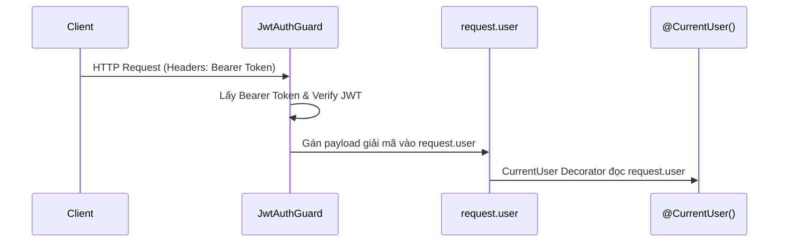

# Nhật ký dự án (25/08/2026)

## 📌 Thay đổi cụ thể trong dự án

- **Module mới**: Thêm module `user-authentication` để quản lý đăng nhập và xác thực người dùng của context `identity`.
- **Quy trình kiểm thử chất lượng code**: Thêm cấu hình tự động chạy 3 lệnh khi hoàn thành công việc:
  - `npm run build`
  - `npm run test`
  - `npm run lint`
- **Đặc tả tài liệu API**: Hoàn thành tài liệu chi tiết về tiêu chuẩn viết endpoint API, bao gồm:
  - Format Request & Response.
  - Quy chuẩn đặt tên Route.
  - Validation dữ liệu đầu vào và xử lý lỗi.
  - Các ví dụ minh họa cụ thể.

---

## 💡 Kiến thức cần ghi nhớ trong dự án ngày hôm nay

- **Khai báo Body JSON**: Được định nghĩa và làm ví dụ trong thư mục `dto/`.
- **Luồng dữ liệu Request & Response**:
  - Request: `Controller` ➔ `Service` ➔ `Domain` ➔ `Repository`
  - Response: Ngược lại (`Repository` ➔ `Domain` ➔ `Service` ➔ `Controller`)

### Luồng xác thực HTTP Request:

> **Các bước chi tiết:**
>
> 1. HTTP Request gửi đến.
> 2. `JwtAuthGuard` chạy.
> 3. Lấy `Bearer token` từ header.
> 4. Verify JWT để giải mã ra `payload`.
> 5. Gán `payload` vào `request.user`.
> 6. `@CurrentUser` decorator đọc dữ liệu từ `request.user`.

## Dự định trong ngày 26/08/2026

- Hoành thành 3 luồn chính: inventory, shopping , finance, commerce
