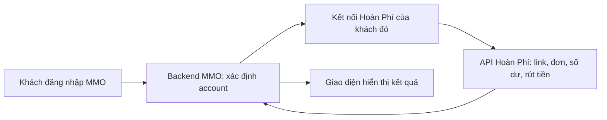

# Hoàn Phí 247: kết quả crawl và cách hoạt động

Ngày kiểm tra: **23/10/2026**, múi giờ Việt Nam. Đối tượng: `https://hoanphi247.vn/` và API `https://hoanphi247.vn/api/v1/openapi`.

**Kết quả quan trọng:** đã thử truy cập trực tiếp bằng công cụ web, HTTP client và trình duyệt Chromium, nhưng chưa lấy được nội dung live. Các lần truy cập trực tiếp đều không nhận phản hồi HTTP trong thời gian chờ. Phần giải thích nghiệp vụ bên dưới dựa trên tài liệu API đang lưu trong repo và code MMO đã đọc, không phải kết quả crawl thành công website hiện tại.

## 1. Đã kiểm tra trực tiếp những gì?

**Crawl** nghĩa là tự động mở trang, đọc nội dung và lần theo liên kết. Muốn crawl tiếp phải lấy được trang đầu tiên. Lượt này chưa có HTML hoặc JSON live để trích xuất liên kết/nội dung.

| Đích công khai | HTTP client | Chromium thật, chạy không mở cửa sổ |
| --- | --- | --- |
| `/` | Timeout khoảng 12 giây, nhận 0 byte nội dung | Timeout khoảng 18 giây, không nhận response điều hướng |
| `/api/v1/openapi/config` | Timeout khoảng 12 giây, nhận 0 byte nội dung | Timeout khoảng 18 giây, không nhận response điều hướng |
| `/robots.txt` | Timeout khoảng 12 giây, nhận 0 byte nội dung | Không thử riêng |
| `/sitemap.xml` | Timeout khoảng 12 giây, nhận 0 byte nội dung | Không thử riêng |
| `/api/v1/openapi/pages` | Không thử riêng bằng curl ở lượt này | Timeout khoảng 18 giây, không nhận response điều hướng |

Nguồn **[LIVE CHECK]**: [bằng chứng kiểm tra đã loại thông tin nhạy cảm](hoanphi247-crawl-evidence-2026-10-23.json). Với bốn request curl, thiết lập TCP/TLS hoàn thành nhưng không nhận nội dung HTTP. `httpStatus: null` là chưa nhận mã HTTP, không phải website trả `401`, `403` hay `500`.

Công cụ web cũng không mở được trang chủ/API; tìm kiếm không cung cấp được kết quả đúng website để làm nguồn thay thế. Thử qua hostname `www`, URL HTTP và dịch vụ đọc trang trung gian cũng không lấy được nội dung bằng công cụ web. Không dùng các kết quả tìm kiếm không liên quan để suy ra nghiệp vụ.

**Chưa xác định** lỗi nằm ở đường mạng, lớp phân phối nội dung hay máy chủ ứng dụng. Không đủ bằng chứng nói website ngừng hoạt động với mọi người hoặc khẳng định bị chặn bởi một cơ chế cụ thể. Ở lượt kiểm tra trước trong cùng cuộc trao đổi, một lần thử `POST /auth/login` bằng tài khoản test cũng timeout; chưa xác nhận được đăng nhập thành công/thất bại. Lượt crawl này chỉ truy cập các URL công khai, không tạo link mua hàng, đơn, lệnh rút hoặc thay đổi tài khoản.

**[USER CLAIM — bổ sung sau kiểm tra]** Chủ dự án xác nhận trình duyệt trên máy cá nhân mở trang chủ bình thường. Vì vậy không coi kết quả timeout ở đây là bằng chứng website ngừng hoạt động. Kiểm tra tiếp bằng cách chọn riêng hai địa chỉ IPv4 công khai của tên miền, hostname `www` và HTTP vẫn timeout sau khoảng 8 giây; dịch vụ đọc trang công khai qua HTTP/HTTPS cũng không trả nội dung sau khoảng 20 giây. Các kết quả bổ sung được ghi trong file bằng chứng. Chưa có kết nối để đọc trực tiếp nội dung trình duyệt đang mở trên máy chủ dự án; cần bản HTML của trang công khai để tiếp tục phân tích nội dung đó nếu đường mạng này vẫn không truy cập được.

## 2. Nguồn nào đang dùng để giải thích?

| Nguồn | Điều nguồn này chứng minh được | Giới hạn |
| --- | --- | --- |
| [dau_api.md](../note/plan/dau_api.md), các mục API Hoàn Phí | Bản tài liệu trong repo mô tả login, link hoàn phí, đơn, số dư, rút tiền, giới thiệu | Chưa xác minh bản này còn khớp website live |
| [CashbackController](../../MMO_Shopping_BE/src/modules/cashback/controllers/cashback.controller.ts) | Các API MMO đang khai báo và cách lấy account từ phiên | Đọc source chưa chứng minh runtime/DB hoạt động |
| [CashbackService](../../MMO_Shopping_BE/src/modules/cashback/services/cashback.service.ts) | Cách MMO gọi provider, giữ kết nối theo account, lấy đơn/ví | Không thấy cách provider tự ghi nhận đơn ở phía trong hệ thống của họ |
| [HoanPhiClientService](../../MMO_Shopping_BE/src/modules/cashback/services/hoanphi-client.service.ts) | Cách gửi HTTP, gắn Bearer token và xử lý timeout | Không chứng minh đăng nhập hoặc thanh toán live đã thành công |
| Lựa chọn của chủ dự án trong cuộc trao đổi | Mỗi khách tự liên kết tài khoản Hoàn Phí riêng | Đây là yêu cầu nghiệp vụ, không phải phát hiện từ website |

Các phần dưới dùng nhãn **[SOURCE FACT — tài liệu repo]**, **[SOURCE FACT — code]**, **[INFERENCE]** hoặc **[UNVERIFIED]** theo [research-reasoning-tutor.md](../../research-reasoning-tutor.md).

## 3. Luồng hoàn phí, giải thích bằng từng việc cụ thể

### Bước 1: khách liên kết tài khoản Hoàn Phí

**[SOURCE FACT — tài liệu repo]** Provider có `POST /auth/login`, nhận email/password và trả token. **Token** là chuỗi chứng minh phiên đăng nhập, dùng khi gọi API tiếp theo. Nếu bật xác thực hai lớp, phải hoàn tất bước mã xác thực trước khi nhận token. Nguồn: [dau_api.md](../note/plan/dau_api.md), mục “Tạo tài khoản & Đăng nhập”, dòng 19–58.

**[SOURCE FACT — code]** `CashbackService.login(accountId, dto)` gửi thông tin khách nhập sang provider. `consumeAuthResult()` mã hóa token và lưu theo `accountId`; `CashbackConnection` có ràng buộc một kết nối trên mỗi account MMO. Nguồn: [CashbackService](../../MMO_Shopping_BE/src/modules/cashback/services/cashback.service.ts), `login`, `consumeAuthResult`; [CashbackConnection](../../MMO_Shopping_BE/src/modules/cashback/entities/cashback-connection.entity.ts), `accountId`.

### Bước 2: đổi link sản phẩm thành link hoàn phí

**[SOURCE FACT — tài liệu repo]** `POST /cashback/link` nhận URL sản phẩm, yêu cầu token và trả `trans_id`, `affiliate_url`, `cashback_amount` trong ví dụ. **Affiliate link** là link giới thiệu có phục vụ việc theo dõi giao dịch. Tài liệu nêu Shopee/TikTok Shop/Lazada, nhưng chưa có cấu hình live để xác nhận nền tảng nào đang bật. Nguồn: [dau_api.md](../note/plan/dau_api.md), mục “Lấy link hoàn tiền”, dòng 60–79; mục `/config`, dòng 4–16.

**[SOURCE FACT — code]** MMO nhận URL tại `POST /api/v1/cashback/link`, gọi `CashbackService.createLink()`, rồi backend gọi provider bằng token của account hiện tại. Frontend `CashbackLinkPage.handleSubmit()` hiển thị link và nhãn “Hoàn phí tạm tính”. Nguồn: [CashbackController](../../MMO_Shopping_BE/src/modules/cashback/controllers/cashback.controller.ts), `createLink`; [CashbackService](../../MMO_Shopping_BE/src/modules/cashback/services/cashback.service.ts), `createLink`; [CashbackLinkPage](../../MMO_Shopping_FE/src/pages/cashback/CashbackLinkPage.tsx), `handleSubmit` và vùng hiển thị kết quả.

### Bước 3: khách mở link và mua trên sàn

**[SOURCE FACT — code]** Màn hình MMO hướng dẫn khách mở link vừa tạo, hoàn tất đơn trên sàn và chờ ghi nhận/đối soát. Nguồn: [CashbackLinkPage](../../MMO_Shopping_FE/src/pages/cashback/CashbackLinkPage.tsx), mảng `steps`, nút “Mua hàng qua link”.

**[INFERENCE]** Tạo link là bước chuẩn bị cho giao dịch được theo dõi. Nó chưa đủ để chứng minh khách đã mua, đơn hợp lệ hoặc có tiền có thể rút. Code tạo link và API đọc đơn là hai thao tác khác nhau. Không được tự cộng `cashback_amount` từ kết quả tạo link vào ví MMO. Cơ sở: `createLink()` và `listOrders()` trong [CashbackService](../../MMO_Shopping_BE/src/modules/cashback/services/cashback.service.ts).

**[UNVERIFIED]** Chưa biết provider dùng callback từ sàn, tác vụ chạy định kỳ hay cơ chế khác để ghi nhận đơn. Chưa xác minh thời gian ghi nhận, cookie theo dõi, quy tắc link cuối cùng, điều kiện từng sàn hoặc tỷ lệ hoàn thực tế. Không suy ra các chi tiết này từ một URL affiliate.

### Bước 4: theo dõi đơn và kết quả duyệt

**[SOURCE FACT — tài liệu repo]** `GET /orders` và `/orders/{id}` cung cấp đơn hoàn phí của thành viên. Tài liệu liệt kê các trạng thái dưới đây. Nguồn: [dau_api.md](../note/plan/dau_api.md), mục “Danh sách đơn hàng”, dòng 174–195.

| Trạng thái | Cách đọc theo tài liệu và tên trạng thái |
| --- | --- |
| `pending` | Đang chờ xử lý/duyệt; chưa coi là khoản chắc chắn nhận được |
| `approved` | Đơn đã được duyệt; cần đọc số dư/điều kiện rút thực tế thay vì suy ra có thể rút ngay |
| `rejected` | Đơn bị từ chối; xem lý do nếu API cung cấp |
| `recalled` | Tài liệu mô tả khoản đã hoàn nhưng bị thu hồi do đơn bị sàn hủy |

**[SOURCE FACT — code]** MMO có API đọc danh sách/chi tiết và UI hiển thị trạng thái, số tiền, lý do từ chối nếu có. Nguồn: [CashbackService](../../MMO_Shopping_BE/src/modules/cashback/services/cashback.service.ts), `listOrders`, `getOrder`; [CashbackOrdersPage](../../MMO_Shopping_FE/src/pages/cashback/CashbackOrdersPage.tsx), `OrderDetail`.

### Bước 5: xem số dư và yêu cầu rút tiền

**[SOURCE FACT — tài liệu repo]** `GET /account` trả hồ sơ/số dư; `GET /balance-logs` trả lịch sử thay đổi số dư. `POST /withdrawals` tạo yêu cầu rút, có thông tin số tiền/tài khoản nhận và OTP nếu được cấu hình; ví dụ trả trạng thái `pending`, chờ xét duyệt. Vì vậy gửi yêu cầu rút chưa đồng nghĩa ngân hàng đã nhận tiền. Nguồn: [dau_api.md](../note/plan/dau_api.md), mục “Thông tin tài khoản & Số dư”, dòng 81–95; “Rút tiền”, dòng 103–127; “Biến động số dư”, dòng 288–302.

**[SOURCE FACT — code]** MMO có `getAccount`, `listBalanceLogs`, `listWithdrawals`, `createWithdrawal`, `sendWithdrawalOtp`. Các hàm gọi provider theo kết nối của account hiện tại. Nguồn: [CashbackService](../../MMO_Shopping_BE/src/modules/cashback/services/cashback.service.ts), các hàm cùng tên.

**[UNVERIFIED]** Chưa đọc được cấu hình live để khẳng định mức rút tối thiểu, phí rút, ngân hàng hỗ trợ, OTP có bắt buộc hay không hoặc thời gian xử lý. Các con số mẫu trong tài liệu không phải cấu hình được xác nhận hôm nay.

## 4. MMO đứng ở đâu trong luồng này?



**[SOURCE FACT — code]** Đây là cách tổ chức đang có trong `CashbackController` và `CashbackService.authenticatedRequest()`: xác thực phiên MMO → lấy `accountId` → tra kết nối → giải mã token → gọi provider. Code gọi API được cung cấp sẵn, không dùng crawler HTML làm luồng nghiệp vụ. Nguồn: [controller](../../MMO_Shopping_BE/src/modules/cashback/controllers/cashback.controller.ts), khai báo `JwtAuthGuard` và `CurrentUser`; [service](../../MMO_Shopping_BE/src/modules/cashback/services/cashback.service.ts), `authenticatedRequest`.

- **[USER CLAIM / quyết định]** Mỗi khách tự liên kết tài khoản Hoàn Phí của mình; không dùng account test của chủ shop cho tất cả khách.
- **[SOURCE FACT — code]** Account MMO cần để định danh dữ liệu. `CashbackController` chỉ yêu cầu phiên hợp lệ, không bắt buộc literal role `USER`, nên admin đăng nhập cũng có thể đi qua luồng cá nhân. `USER` là quyền mặc định của khách trong thiết kế shop, không phải quyền được gửi sang provider.
- **[SOURCE FACT — code]** Token Hoàn Phí được backend mã hóa bằng `IntegrationCredentialService`, không trả trực tiếp qua `serializeConnection()`. Các biến test trong `.env` không phải cách backend tự đăng nhập thay mọi khách. Nguồn: [CashbackService](../../MMO_Shopping_BE/src/modules/cashback/services/cashback.service.ts), `login`, `consumeAuthResult`, `serializeConnection`; [IntegrationCredentialService](../../MMO_Shopping_BE/src/modules/cashback/services/integration-credential.service.ts), `encrypt`.

**[ILLUSTRATIVE EXAMPLE]** Khách A tạo link bằng kết nối Hoàn Phí A; khách B tạo link bằng kết nối Hoàn Phí B. Khi A mở trang hoàn phí, backend dùng kết nối A để lấy dữ liệu của A. Ví mua hàng số MMO được quản lý trong module `finance`, còn số dư Hoàn Phí đọc qua API provider; không hiển thị hai nguồn thành một số dư chung. Nguồn về hai mô hình dữ liệu: [Wallet](../../MMO_Shopping_BE/src/modules/finance/entities/wallet.entity.ts) và `CashbackService.getAccount()` ở trên.

## 5. Ba khái niệm dễ bị gọi chung là seller/affiliate

| Khái niệm | Hiểu trong phạm vi đang kiểm tra | Bằng chứng |
| --- | --- | --- |
| Người bán trên Shopee/TikTok/Lazada | Bên bán sản phẩm mà link trỏ tới; chưa kiểm tra cơ chế quản lý seller của các sàn | Tài liệu repo, mục “Lấy link hoàn tiền”; không suy ra có role tương ứng trong MMO |
| Referral của Hoàn Phí | Chức năng giới thiệu thành viên F1/F2 và hoa hồng của provider | [dau_api.md](../note/plan/dau_api.md), mục “Giới thiệu F1/F2”, dòng 269–285; `CashbackService.getReferrals()` |
| Module `sellers` trong MMO | Hồ sơ seller, mã giới thiệu nội bộ, click, phê duyệt | [SellersService](../../MMO_Shopping_BE/src/modules/sellers/services/sellers.service.ts), `createProfile`, `generateReferralCode`, `trackReferralClick` |

**[SOURCE FACT — code]** `CashbackService` dùng kết nối provider riêng, không gọi `SellersService` để đăng nhập Hoàn Phí. Do đó chưa có cơ sở nói cần role `SELLER` nội bộ để đấu nối Hoàn Phí. Kế hoạch seller và phần cashback cần được xử lý độc lập.

## 6. Cách kiểm tra tiếp khi truy cập được website

1. Mở trang chủ, lấy các liên kết thật dẫn đến hướng dẫn/chính sách/tài liệu API; ghi ngày, URL và nội dung đã đọc. Không coi đường dẫn phỏng đoán là trang đã tồn tại.
2. Đọc `/config`, `/pages` và các trang chi tiết được trả về; đối chiếu nền tảng bật, điều kiện ghi nhận và cấu hình rút hiện hành.
3. Dùng tài khoản test được chủ dự án cho phép: đăng nhập, hoàn tất 2FA nếu yêu cầu, đọc hồ sơ và lịch sử đơn/rút có sẵn; không tạo lệnh tiền chỉ để chứng minh kết nối.
4. Đối chiếu phản hồi thật với DTO/normalizer/UI MMO: kiểu tiền, trạng thái đơn, pagination, lỗi token hết hạn và quyền sở hữu.
5. Muốn xác minh trọn luồng phát sinh đơn cần một giao dịch thử được thống nhất riêng và thời gian chờ duyệt thực tế; crawl trang công khai không chứng minh được bước thanh toán/chi trả.

Có thể thử hai URL công khai trên máy truy cập được website:

```bash
curl --connect-timeout 5 --max-time 15 --fail-with-body https://hoanphi247.vn/api/v1/openapi/config
curl --connect-timeout 5 --max-time 15 --fail-with-body https://hoanphi247.vn/api/v1/openapi/pages
```

**Trạng thái:** đã hoàn thành thử truy cập bằng nhiều cách và phân tích nguồn trong repo; việc crawl nội dung live còn chưa thực hiện được do không nhận HTTP response từ môi trường kiểm tra. Chưa có bằng chứng xác minh end-to-end — tức toàn bộ luồng từ tạo link đến nhận tiền. Đợt này không sửa code tích hợp hoặc database.
