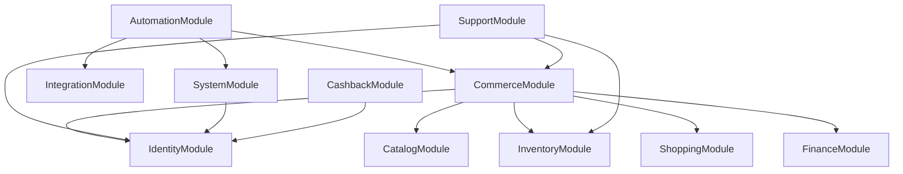

# Kiến Trúc Backend NestJS

> Stack: NestJS, PostgreSQL, TypeORM code-first, TypeScript.
> Tài liệu gốc: `docs/database/entities.md`, `docs/database/userStory.md`, `docs/rule/schema.md`, `docs/rule/helper.md`.

> **Mô hình chuẩn — 23/10/2026:** [Shop một chủ](../business/single-owner-shop.md): `ADMIN` chính là chủ shop, quản lý hàng/kho/đơn; `USER` mua hàng. Sơ đồ cốt lõi dưới đây chưa bao quát mọi module mở rộng trong source. `AppModule` hiện còn nạp `SellersModule`, pricing, campaign và seed; Namespace seller hiện trả 410, Price Engine/SeedModule đã tháo phụ thuộc seller; module/entity cũ giữ lịch sử. Xem [đối chiếu API](../api/single-owner-shop.md) và [plan](../plan/single-owner-shop.md) để tháo đúng thứ tự. Xem [trạng thái triển khai tạm ngừng](../changes/seller-role-disabled-2026-10-23.md); chưa chuyển dữ liệu hoặc xóa schema.

## 1. Tổng Quan

Backend được tổ chức theo **modular monolith, DDD-inspired**. Mỗi module sở hữu entity của bounded context tương ứng, còn workflow liên module đi qua service/port rõ ràng.



Nguyên tắc chính:

- `CommerceModule` điều phối checkout/order/voucher.
- `FinanceModule` sở hữu ví, payment transaction và ledger.
- `AutomationModule` sở hữu request mã tiếp sức, fan-out sang tools và tổng hợp `boolean[]`.
- `IntegrationModule` sở hữu endpoint tools và credentials mã hóa.
- `SupportModule` sở hữu ticket conversation và warranty claim.
- `SystemModule` sở hữu outbox, setting không nhạy cảm và audit log.
- `CashbackModule` là façade allowlist tới Hoàn Phí 247, sở hữu connection/token mã hóa theo từng account MMO.

## 2. Cấu Trúc Module

```text
MMO_Shopping_BE/src/
├── common/base
├── config
├── database
└── modules
    ├── identity
    ├── catalog
    ├── inventory
    ├── shopping
    ├── commerce
    ├── finance
    ├── integration
    ├── automation
    ├── support
    └── system
    └── cashback
```

## 3. Entity Ownership

| Module        | Sở hữu                                                     |
| :------------ | :--------------------------------------------------------- |
| `identity`    | `Role`, `Account`, `AuthSession`                           |
| `catalog`     | `Category`, `Product`, `ProductCategory`, `ProductVariant` |
| `inventory`   | `InventoryItem`                                            |
| `shopping`    | `Cart`, `CartItem`, `Favorite`, `ProductView`              |
| `commerce`    | `Voucher`, `VoucherRedemption`, `Order`, `OrderItem`       |
| `finance`     | `Wallet`, `PaymentTransaction`, `WalletTransaction`        |
| `integration` | `IntegrationEndpoint`                                      |
| `automation`  | `SupportCodeRequest`, `SupportDispatch`                    |
| `support`     | `SupportTicket`, `SupportMessage`, `WarrantyClaim`         |
| `system`      | `OutboxEvent`, `SystemSetting`, `AdminAuditLog`            |
| `cashback`    | `CashbackConnection`                                       |

### Hoàn phí bên thứ ba

- FE chỉ gọi `/api/v1/cashback/*` bằng JWT MMO hiện tại.
- User liên kết tài khoản Hoàn Phí 247 một lần; backend chỉ lưu access token đã mã hóa, không lưu mật khẩu.
- Provider `401` được đổi thành `409 CASHBACK_REAUTH_REQUIRED` để không kích hoạt nhầm refresh JWT MMO.
- Config provider được cache 5 phút; dữ liệu ví, đơn, rút tiền và referral không cache.

## 4. Workflow Chính

### Auth

- Register tạo `Account`, `Cart`, `Wallet`.
- Login tạo `AuthSession`, lưu hash refresh token.
- Refresh rotate token, đánh dấu session cũ được thay bởi session mới.
- Logout set `revokedAt`; logout-all revoke mọi session còn hiệu lực.

### Checkout

- Cart item luôn trỏ `ProductVariant`.
- Tính giá từ variant active, áp voucher nếu hợp lệ.
- Tạo `Order`, `OrderItem`, `VoucherRedemption`.
- Debit ví và ghi `WalletTransaction` trong cùng DB transaction.
- Giữ/giao `InventoryItem` bằng row lock hoặc atomic update.

### Mã Tiếp Sức

- User nhập `code` + `quantity`, backend tạo `SupportCodeRequest` trạng thái `ACTIVE`.
- Sau khi order ví thanh toán thành công, request chuyển `PROCESSING` và ghi `OutboxEvent`.
- Worker đọc outbox, tạo `SupportDispatch` cho từng `IntegrationEndpoint` active.
- Tool callback theo HMAC/timestamp/idempotency.
- Backend tổng hợp `SupportDispatch.result` thành `SupportCodeRequest.resultFlags`.
- Tất cả `true` là `SUCCESS`, tất cả `false` là `FAILED`, kết quả lẫn lộn là `PARTIAL_SUCCESS`.

### Ticket & Warranty

- Ticket V1 dùng REST polling, gồm `SupportTicket` và `SupportMessage`.
- Warranty claim gắn với `OrderItem` và `InventoryItem` đã bán.
- Khi duyệt claim, admin gán `replacementInventoryItemId` và audit bằng `AdminAuditLog`.

## 5. Quy Tắc Kỹ Thuật

- Không gọi tools/cổng thanh toán khi DB transaction còn mở.
- External side effect đi qua `OutboxEvent`.
- Secret của tools chỉ lưu dạng mã hóa trong `IntegrationEndpoint.encryptedCredentials`.
- Setting chung không nhạy cảm lưu ở `SystemSetting`.
- Báo cáo/dashboard ưu tiên query/read model từ dữ liệu giao dịch, không tạo entity tổng hợp khi chưa cần cache.

## 6. Roadmap Triển Khai API

1. Hoàn thiện migration từ entity hiện tại.
2. Implement auth/session: register, login, refresh, logout, logout-all.
3. Implement catalog/shopping API: list/detail/filter, cart, favorite, product view.
4. Implement finance/commerce API: deposit callback, checkout, voucher redemption, order history.
5. Implement automation/integration API: endpoint CRUD, support-code create/pay/status/callback/retry.
6. Implement support API: tickets, messages, warranty claims.
7. Implement admin reporting và audit log.

## 7. Kiểm Thử Bắt Buộc

- `npm run build`, `npm run lint`.
- Migration up/down/up trên database test sạch.
- Concurrency test cho wallet debit và inventory reservation.
- Idempotency test cho payment callback, support callback, outbox worker.
- Access-control test: user không xem order/ticket/claim của user khác.
- Secret redaction test: không trả `encryptedCredentials` trong response admin thông thường.
