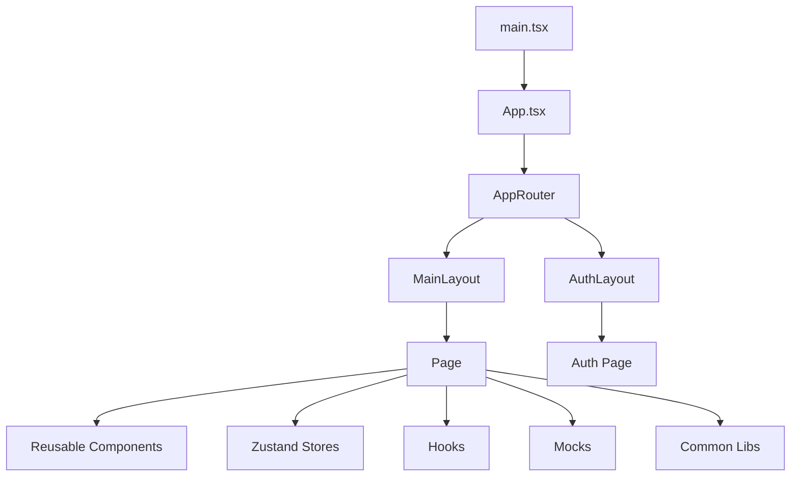
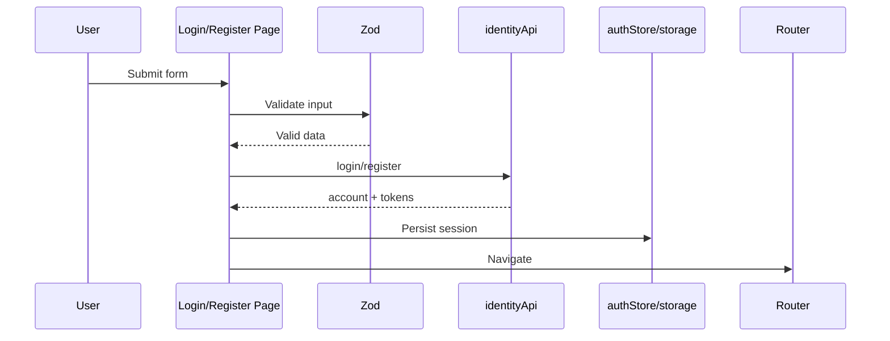
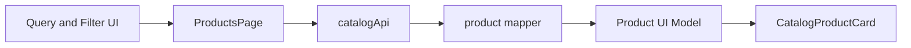
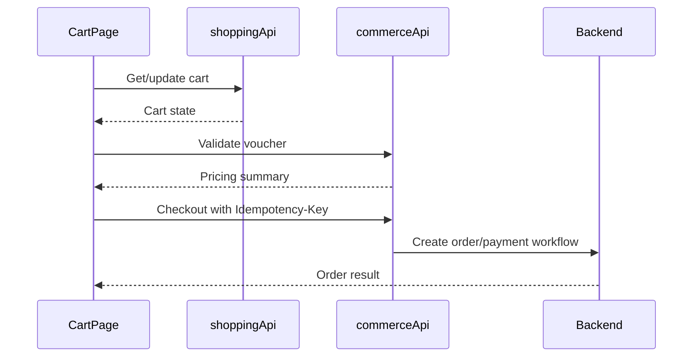
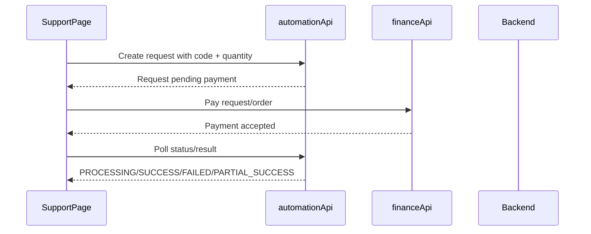

# Kiến Trúc Frontend React

> Mục đích: mô tả kiến trúc frontend hiện tại và hướng kiến trúc khi kết nối backend.
> Nguồn tổng hợp: `MMO_Shopping_FE/package.json`, `MMO_Shopping_FE/src`, `MMO_Shopping_FE/docs/rules`, `docs/structure/BE.md`.

> **Đối chiếu 23/10/2026:** Nghiệp vụ đích là [shop một chủ](../business/single-owner-shop.md); khu `/admin/*` là công cụ chủ shop bán hàng và quản lý kho chung. Router hiện có Chung Sức, cashback và admin, không mở route seller dù `pages/seller/SellerDashboardPage.tsx` còn trên đĩa. Không dùng README seller cũ để thêm lại route. Xem [API](../api/single-owner-shop.md), [plan](../plan/single-owner-shop.md), [rule](../rule/business.md). Các mô tả theo giai đoạn bên dưới cần đọc cùng ghi chú này.

## 1. Tổng Quan

Frontend hiện được tổ chức theo hướng **route-driven UI**.

Luồng chính:

```text
main.tsx -> App.tsx -> AppRouter -> Layout -> Page -> Component
```

Ý nghĩa từng lớp:

- `main.tsx` render React app vào DOM.
- `App.tsx` hiện chỉ render `AppRouter`.
- `AppRouter` khai báo route và chọn layout/page.
- `Layout` định nghĩa khung giao diện chung.
- `Page` điều phối workflow của màn hình.
- `Component` render UI tái sử dụng.

Stack hiện tại:

| Nhóm | Công nghệ |
| :-- | :-- |
| UI runtime | React 19, React DOM 19 |
| Build | Vite 8, TypeScript 6 |
| Routing | React Router DOM 7 |
| Styling | Tailwind CSS 4, `clsx`, `tailwind-merge` |
| Client state | Zustand 5 |
| HTTP | Axios |
| Validation | Zod |

Ghi chú:

- React Compiler đang bật qua `babel-plugin-react-compiler` và `reactCompilerPreset()`.
- Nên dùng `pnpm` cho frontend vì có `pnpm-lock.yaml`.
- Script hiện có: `pnpm dev`, `pnpm build`, `pnpm lint`, `pnpm preview`.
- Project chưa có script test hoặc test framework trong `package.json`.

## 2. Kiến Trúc Hiện Tại



Vai trò thư mục trong `MMO_Shopping_FE/src`:

| Thư mục | Vai trò hiện tại |
| :-- | :-- |
| `assets` | Chứa image/svg tĩnh dùng cho UI. |
| `common/apis` | Chứa HTTP client chuẩn tại `httpClient.ts` và API theo nghiệp vụ. |
| `common/const` | Chứa route constants, storage keys, API path constants. |
| `common/libs` | Chứa formatter, validation, storage, className helper, product catalog helper và Axios client có interceptor. |
| `common/mocks` | Chứa mock products và mock auth. |
| `common/models` | Chứa type/model dùng chung cho product, user, response, pagination. |
| `common/stores` | Chứa Zustand store cho auth và cart. Đây là thư mục đang tồn tại trong source hiện tại. |
| `components` | Chứa reusable UI components như Button, Input, Header, Footer, ProductCard, OrderSummary. |
| `hooks` | Chứa reusable React hooks như `useAsync`, `useDebounce`. |
| `layouts` | Chứa `MainLayout` và `AuthLayout`. |
| `pages` | Chứa các route-level screens. |
| `routes` | Chứa route definitions và lazy page imports. |

Ghi chú về `common/mapping`:

- Rule FE gốc có đề xuất `common/mapping` cho data transformers.
- Thư mục đã được tạo khi nối API identity + catalog: `common/mapping/identity.ts` (account → User UI) và `common/mapping/catalog.ts` (product DTO → Product UI).
- Khi API model khác UI model, mapper nên đặt tại `common/mapping`.

## 3. Route Và Layout

Routes đang được khai báo trong `src/routes/index.tsx`.

Page được lazy-load trong `src/routes/lazyComponents.ts` và render qua `Suspense`.

| Route | Page | Layout | Trạng thái |
| :-- | :-- | :-- | :-- |
| `/` | `HomePage` | `MainLayout` | Hiện có |
| `/products` | `ProductsPage` | `MainLayout` | Hiện có |
| `/products/:id` | `ProductDetailPage` | `MainLayout` | Hiện có |
| `/cart` | `CartPage` | `MainLayout` | Hiện có |
| `/support` | `SupportPage` | `MainLayout` | Hiện có |
| `/cashback/*` | `CashbackCenterPage` + các page nghiệp vụ | `MainLayout` + `CashbackLayout` | Hoàn phí qua BE façade |
| `/policy` | `PolicyPage` | `MainLayout` | Hiện có |
| `/contact` | `ContactPage` | `MainLayout` | Hiện có |
| `/login` | `LoginPage` | `AuthLayout` | Hiện có |
| `/register` | `RegisterPage` | `AuthLayout` | Hiện có |
| `/admin` | `AdminDashboardPage` | `AdminLayout` | Admin v1 |
| `/admin/accounts` | `AdminAccountsPage` | `AdminLayout` | Admin v1 |
| `/admin/catalog` | `AdminCatalogPage` | `AdminLayout` | Admin v1 |
| `/admin/inventory` | `AdminInventoryPage` | `AdminLayout` | Admin v1 |
| `/admin/orders` | `AdminOrdersPage` | `AdminLayout` | Admin v1 |
| `/admin/vouchers` | `AdminVouchersPage` | `AdminLayout` | Admin v1 |
| `/admin/finance` | `AdminFinancePage` | `AdminLayout` | Admin v1 |
| `/admin/audit-logs` | `AdminAuditLogsPage` | `AdminLayout` | Admin v1 |
| `*` | `NotFoundPage` | `MainLayout` | Hiện có |

Layout hiện tại:

- `MainLayout` dùng cho các trang public/shop: Header, Footer và vùng nội dung chính.
- `AuthLayout` dùng cho đăng nhập và đăng ký.
- `AdminLayout` dùng cho khu vực quản trị: sidebar + topbar, không gọi API, không chứa business logic.

Chưa có trong source hiện tại:

- Protected route. _(đã có `RequireAuth` bọc `/cart` và `/support`; `RequireAdmin` bọc `/admin/*` — chưa có user account area)_
- User account area.

Kiến trúc đích cho admin v1:

- `components/RequireAdmin` bọc route `/admin/*`, chặn guest và user không phải `admin` (dựa `useAuthStore.user.role`).
- `layouts/AdminLayout` định nghĩa sidebar + topbar, nhận `children`.
- `pages/admin/*` chứa các page admin, mỗi page gọi `adminApi` và điều phối state/validation.
- `common/apis/adminApi.ts` (hoặc chia theo domain) chứa request tới `/api/v1/admin/*`.
- `common/models` + `common/mapping` chứa DTO/mapper cho entity admin (account, category, product, variant, inventory, order, voucher, transaction, report, audit log).
- Shared admin UI (table, status badge, filter bar, form modal/drawer, confirm dialog, pagination) đặt trong `components` để tái sử dụng.

## 4. Phân Tầng Trách Nhiệm

Quy ước triển khai:

- `pages` điều phối dữ liệu, state, validation và workflow của màn hình.
- `components` nhận props, render UI, phát event và chỉ giữ UI state nhỏ nếu cần.
- `layouts` định nghĩa khung giao diện chung; không gọi API và không chứa business logic.
- `hooks` đóng gói logic React tái sử dụng.
- `common/stores` giữ client/session state.
- `common/apis` chứa request theo domain backend.
- `common/models` chứa type/domain model dùng chung.
- `common/mapping` chứa mapper khi API DTO khác UI model.

Sau khi kết nối backend:

- Không coi Zustand/localStorage là nguồn dữ liệu chuẩn cho cart, order hoặc wallet.
- Backend là nguồn dữ liệu chuẩn cho server state.
- LocalStorage chỉ nên giữ token/session metadata hoặc draft nhẹ.

Chiều import khuyến nghị:

```text
routes
  -> layouts/pages
  -> components/hooks/common/stores/common/apis
  -> common/models/common/libs/common/const
```

Ràng buộc:

- `common` không import ngược từ `pages`, `layouts` hoặc `components`.
- Page-specific logic không đưa vào `common` nếu chưa có nhu cầu tái sử dụng rõ ràng.
- Component dùng chung không phụ thuộc trực tiếp vào mock data hoặc API service.

## 5. Hiện Trạng Dữ Liệu

Sau đợt nối API (Giai đoạn 1 + 2), identity và catalog đã chuyển sang backend; cart/voucher/checkout vẫn còn mô phỏng phía client.

Hiện tại:

- Catalog và product detail dùng `catalogApi` (`GET /products`, `GET /products/{id}`) qua mapper `common/mapping/catalog.ts`.
- Login/register dùng `identityApi` (`/auth/login`, `/auth/register`); register trả token và tự đăng nhập.
- Session restore qua `GET /auth/me` khi app khởi động; có `RequireAuth` bọc `/cart` và `/support`.
- Cart vẫn dùng localStorage draft qua `useCartStore` (chưa chuyển sang server cart — GĐ3).
- Voucher, checkout, contact và support-code vẫn là mô phỏng phía client.
- Trung tâm Hoàn phí dùng `cashbackApi` qua backend façade. Mỗi MMO account liên kết một provider account; FE không giữ provider token.

HTTP hiện tại:

- Client chuẩn cho luồng duy trì là `common/apis/httpClient.ts` (baseURL + timeout + bearer interceptor + envelope parser + refresh single-flight). Source còn client cũ ở `services/api.ts`; phải rà consumer trước khi dọn, không khẳng định đã hợp nhất toàn bộ.
- `common/apis/axios.ts` và `common/libs/request.ts` đã bị xóa.
- Đã có refresh-token flow hoàn chỉnh: retry một lần, refresh single-flight, xóa session khi refresh thất bại và chuyển về `/login`.

API path hiện tại:

- `API_PATHS` đã có đủ nhóm auth, categories, products, product-views, cart, vouchers, checkout.
- Các path đã được đối chiếu với controller backend thật (`/api/v1`); path sai `/cart/add` đã bị xóa, thay bằng `/cart/items`.

## 6. Kiến Trúc Tích Hợp Backend

Khi chuyển từ mock sang backend, frontend nên đi theo mô hình sau:

```mermaid
graph LR
    Page[Page] --> DomainApi[Domain API]
    DomainApi --> HttpClient[HTTP Client]
    HttpClient --> Backend[/api/v1 Backend]
    DomainApi --> Mapper[Mapper]
    Mapper --> UIModel[UI Model]
    Page --> Store[Local UI or Session Store]
```

HTTP client chuẩn:

- Chỉ giữ một Axios client dùng chung.
- Dùng `VITE_API_BASE_URL` làm base URL.
- Có timeout và JSON headers mặc định.
- Gắn bearer token từ auth store/storage khi cần.
- Parse response envelope chuẩn của backend.
- Xử lý lỗi HTTP theo một format thống nhất.
- Xử lý `401` theo flow thống nhất: refresh token nếu có thể, nếu refresh fail thì logout và điều hướng về login.

Domain API nên tách theo module backend:

| Frontend API | Backend module |
| :-- | :-- |
| `identityApi` | `identity` |
| `catalogApi` | `catalog` |
| `shoppingApi` | `shopping` |
| `commerceApi` | `commerce` |
| `financeApi` | `finance` |
| `automationApi` | `automation` |
| `cashbackApi` | `cashback` façade tới Hoàn Phí 247 |
| `supportApi` | `support` |
| `systemApi` hoặc `adminApi` | `system` và admin reporting |

Mapper và model:

- Không đưa DTO backend trực tiếp vào component nếu shape khác UI.
- Mapper đổi API response sang UI model.
- Money từ API giữ dạng decimal string ở transport/domain model.
- Không dùng JavaScript `number` để tính nghiệp vụ tiền.
- Chỉ format tiền khi render hoặc trong formatter.

State:

- Server state gồm catalog, cart, voucher, order, wallet, support request, ticket.
- Local UI state gồm filter đang chọn, modal, loading cục bộ, draft form.
- Sau đăng nhập, cart/order/wallet từ backend là nguồn dữ liệu chuẩn.

## 7. Data Flow Chính

### Auth



### Catalog



### Cart Và Checkout



### Support-Code



## 8. Design System Và Chất Lượng

Design nên bám các rule FE gốc:

- `MMO_Shopping_FE/docs/rules/design.md`
- `MMO_Shopping_FE/docs/rules/reuse.md`
- `MMO_Shopping_FE/docs/rules/structure.md`

Nguyên tắc UI:

- Giữ dark SaaS/cyber marketplace style đang có.
- Dùng màu nhấn có kiểm soát.
- Typography rõ, dễ scan, không scale font theo viewport width.
- Component dùng lại đặt trong `components`.
- Logic chia sẻ đặt trong `hooks` hoặc `common`.
- Page gọi API cần có loading, empty, error, unauthorized và disabled state.
- Responsive layout cần kiểm tra trên mobile và desktop.
- Tránh text tràn container hoặc che nội dung khác.

Quality gate hiện tại:

- `pnpm lint`.
- `pnpm build`.

Roadmap quality:

- Thêm component tests cho form, cart, checkout.
- Thêm e2e tests cho auth, catalog, checkout, support-code.
- Không mô tả test như năng lực đã có trước khi thêm test runner/script.

## 9. Roadmap Frontend

1. Hợp nhất HTTP client, chuẩn hóa API envelope, error handling và auth interceptor.
2. Chuẩn hóa `common/apis`, `common/models`, `common/mapping` theo domain backend.
3. Kết nối identity API cho login, register, refresh, logout và session restore.
4. Kết nối catalog API cho list/detail/filter, thay thế `MOCK_PRODUCTS`.
5. Chuyển cart, voucher và checkout sang backend shopping/commerce API.
6. Thêm wallet, order history và delivery result sau khi finance/commerce API ổn định.
7. Triển khai support-code UI với automation API khi backend automation/support sẵn sàng.
8. Thêm ticket, warranty claim và support conversation.
9. Thêm `AdminLayout`, protected admin routes, dashboard/reporting và system audit views. _(Admin v1 đã thực hiện: route `/admin/*` + dashboard/accounts/catalog/inventory/orders/vouchers/finance/audit-logs.)_

## 10. Checklist Khi Cập Nhật Tài Liệu

- Đối chiếu route với `src/common/const/app.ts` và `src/routes/index.tsx`.
- Đối chiếu dependency/script với `MMO_Shopping_FE/package.json`.
- Đối chiếu folder ownership với `MMO_Shopping_FE/docs/rules/structure.md`.
- Phân biệt rõ "hiện tại" và "kiến trúc đích".
- Không mô tả API, admin route, protected route hoặc test framework như tính năng đã có nếu source chưa triển khai.
- Kiểm tra Mermaid render hợp lệ trong Markdown viewer.
